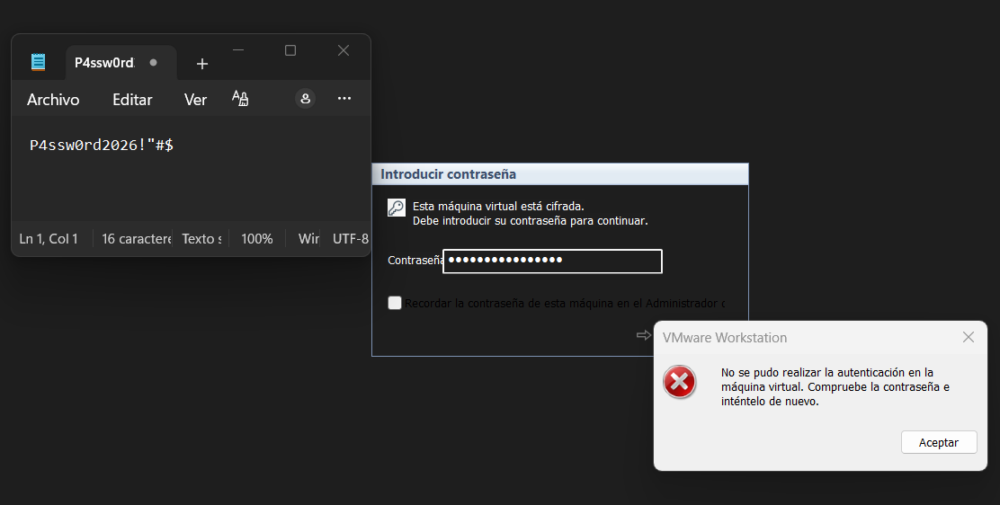
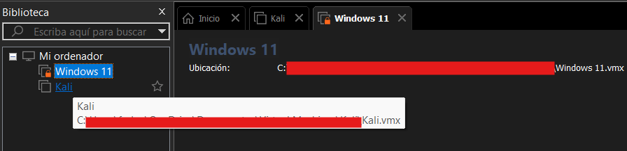
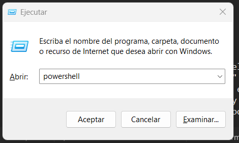
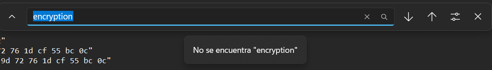
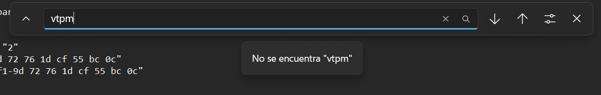
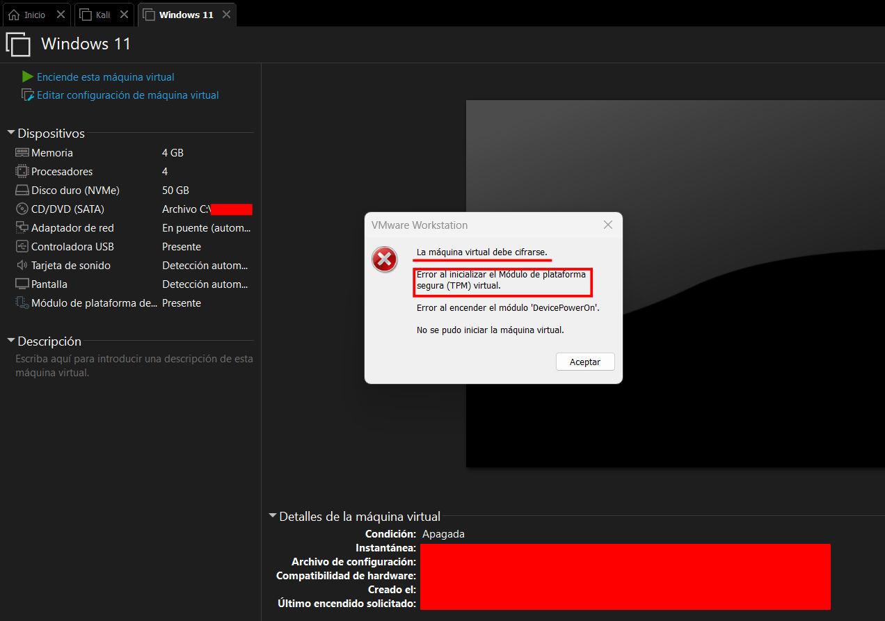
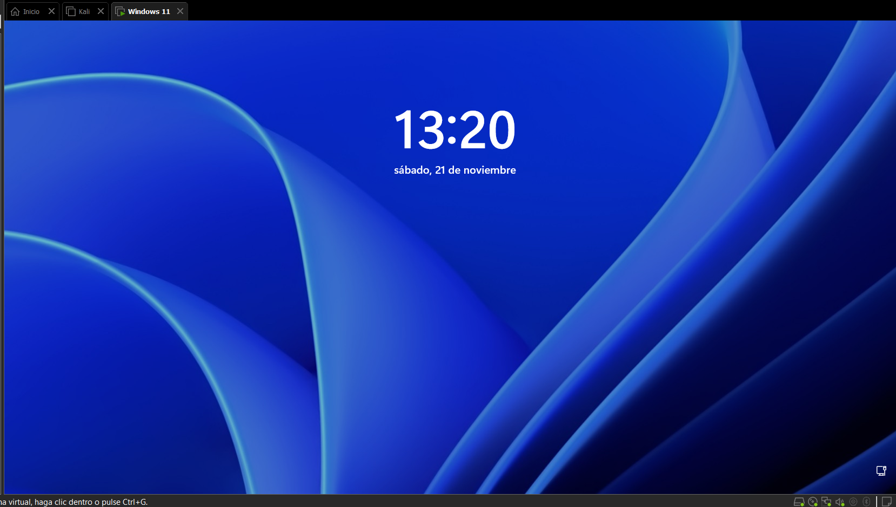

## Info

¿Qué tal chicos? Espero que todo bien. En esta oportunidad les traigo la solución al susto que pasé por no poder abrir mi VM de Windows cifrada. No sabría explicar con precisión qué fue lo que pasó, pero sí cómo salí de ahí.


> **Resumen:** Si cifraste la VM con **fast encryption** y ya no puedes entrar con tu contraseña, puedes quitar el cifrado editando el archivo `.vmx` y eliminando las líneas `encryption.*`, `vmx.encryptionType` y las del `vtpm`. **No recuperas la contraseña:** lo que haces es quitar el cifrado sin ella.
{: .prompt-info }

Sin tanto relleno, vamos a ello.

## Contexto

Como de costumbre, abro mis 2 VMs: **Kali Linux** y **Windows 11**, con el propósito de jugar en HTB. La de Kali no está cifrada, pero cuando virtualicé Windows 11 en VMware Workstation Pro me exigió una contraseña (la verdad no recuerdo del todo). Dije "bueno, va, pongamos una contraseña larga y segura, con la máxima entropía posible" xD.

Todo iba bien hasta hace dos días: escribía la clave y listo, a jugar. Pero hoy, al ingresar exactamente la misma contraseña, me apareció esto:


*Mensaje de autenticación fallida (Contraseña de ejemplo)*

Volví a intentarlo y el resultado fue el mismo. Probé algunas variaciones de la contraseña, pero nada: seguía el mismo mensaje. También revisé si la distribución de mi teclado había cambiado, pero seguía igual que siempre. En este punto ya estaba sudando frío.

Hice lo clásico de informática: reiniciar todo. Pero la respuesta era clara: no tendría acceso a la VM y, por tanto, adiós scripts, binarios y demás datos.

## Buscando soluciones

Con las opciones agotadas, me fui a la web. A grandes rasgos, me llegaron dos preguntas a la cabeza:

1. ¿Hay alguna forma de recuperar mi contraseña perdida?
2. ¿Hay alguna forma de eliminar el cifrado?

### Recuperar la contraseña

Estos fueron los primeros recursos que revisé:

- [Recovering a forgotten encryption password in Workstation Pro - Broadcom](https://community.broadcom.com/vmware-cloud-foundation/discussion/recovering-a-forgotten-encryption-password-in-workstation-pro)
- [Recovery password from encrypted VMware - Reddit](https://www.reddit.com/r/vmware/comments/1n8bq22/recovery_password_from_encrypted_vmware/)
- [Change the password for an encrypted VM - Broadcom TechDocs](https://techdocs.broadcom.com/us/en/vmware-cis/desktop-hypervisors/workstation-pro/25H2/using-vmware-workstation-pro/configuring-and-managing-virtual-machines/encrypting-and-restricting-virtual-machines-ws-guide/change-the-password-for-an-encrypted-vm-workstation.html)

Son bastante prometedores en otras situaciones, pero mi caso quedaba fuera de su alcance. Y es que **VMware no ofrece ninguna forma oficial de recuperar la contraseña si la pierdes**.

### Eliminar el cifrado

Tras probar la mayoría de métodos sin éxito, lo que quedaba era eliminar el cifrado. Después de una búsqueda larga, encontré lo siguiente:

- [VM encrypted itself, don't know the password - Broadcom](https://community.broadcom.com/vmware-cloud-foundation/discussion/vm-encrypted-itself-dont-know-the-password-part2-after-135-update)
- [Move a Windows 11 VM with TPM to a new computer - Reddit](https://www.reddit.com/r/vmware/comments/tkeu8q/move_a_windows_11_vm_with_tpm_to_a_new_computer/)
- [This VM is encrypted and I don't know the password - Reddit](https://www.reddit.com/r/vmware/comments/1gdm386/this_vm_is_encrypted_and_i_dont_know_the_password/)
- [Win11 VMware: This virtual machine is encrypted - Tistory](https://zeliard.tistory.com/entry/win11-vmware-this-virtual-machine-is-encrypted-you-must-enter-its-password-to-continue)
- [ How to Remove Forgotten Password Encryption On VMware Workstation - Youtube](https://www.youtube.com/watch?v=qZl7sz4cCgk)

El artículo de Tistory y el video de YouTube fueron los que más se parecían a mi caso. Todo depende de cómo se haya cifrado la VM (**fast encryption** o **full encryption**), y en mi caso, para mi suerte, fue **fast encryption**.

## Fast encryption vs. full encryption

Antes de tocar nada, hay que tener claro qué cifró VMware:

- **Fast encryption (partial):** solo se cifran los archivos mínimos para que funcione el vTPM (`.nvram`, `.vmss`, `.vmem`, `.vmx` y `.vmsn`). **El disco virtual no se cifra**, por eso este método funciona.
- **Full encryption:** además se cifra el disco. Aquí borrar líneas del `.vmx` **no sirve**, porque sin la contraseña no hay forma de leer los datos del disco.

> Este método solo aplica si tu VM usa **fast encryption**. Puedes confirmarlo viendo `vmx.encryptionType = "partial"` en el `.vmx`.
{: .prompt-warning }

> **Snapshots y VMs suspendidas:** como los archivos `.vmsn`, `.vmss` y `.vmem` también forman parte de lo cifrado, si tu VM tenía snapshots o estaba suspendida es muy probable que ese estado ya no se pueda recuperar. En mi caso la VM arrancó normal y no usaba snapshots.
{: .prompt-warning }

## Recuperando el acceso a la VM

### Ubicar el archivo .vmx

Primero hay que ubicar el archivo `.vmx` de la VM de Windows 11. Se puede ver la ruta de dos formas:

- En la parte superior izquierda de la VM de Windows 11.
- Pasando el cursor sobre la VM, en la sección **Biblioteca**.


*Ruta del archivo .vmx*

### Editar el .vmx

Cierra VMware, presiona `Win + R` para abrir **Ejecutar** y abre una PowerShell normal, con el usuario actual (sin privilegios).


*PowerShell sin privilegios*

Ve a la ruta absoluta que vimos antes.

```powershell
cd '<ABSOLUTE PATH TO VIRTUAL MACHINES>'
```

Haz una copia de seguridad del archivo `.vmx`.

```powershell
Copy-Item '.\Windows 11.vmx' '.\Windows 11.vmx.bak'
```

Ábrelo con Notepad.

```powershell
notepad.exe '.\Windows 11.vmx'
```

Y elimina las siguientes líneas.

```shell
vmx.encryptionType = "partial"
vtpm.ekCSR = "<STRING>"
vtpm.ekCRT = "<STRING>"
vtpm.present = "TRUE"
encryption.keySafe = "<STRING vmware:key/list>"
encryption.data = "<STRING>"
```

Para verificar, busca (`Ctrl + F`) las palabras `encryption` y `vtpm`: no debe haber ninguna coincidencia.



*Sin coincidencias para "encryption" ni "vtpm"*

### ¿Por qué hay que quitar también las líneas del vtpm?

Porque el vTPM **depende del cifrado de la VM**: no puede existir sin él. Si quitas solo las líneas de cifrado y dejas las del `vtpm`, VMware no puede arrancar la máquina y te muestra este error:


*VM liberada, pero con problema por el TPM*

Si te pasa, cierra, elimina las líneas de `vtpm`, guarda e inicia la máquina de nuevo.

### Iniciar la VM

Guarda el archivo, abre VMware Workstation Pro e inicia la máquina virtual.


*Windows 11 iniciado sin contraseña de VM*

Finalmente, cierra el `.vmx` y sal de PowerShell.

```powershell
exit
```

## Cosas a tener en cuenta

> **TPM y BitLocker:** al quitar el `vtpm`, la VM pierde su TPM virtual. El cifrado de VMware no está ligado al cifrado de disco de Windows, pero si dentro de Windows tenías BitLocker o cifrado de dispositivo activo, puede que te pida la clave de recuperación. Si quieres volver a tener TPM, tendrás que volver a cifrar la VM y agregar el dispositivo desde la configuración de VMware.
{: .prompt-info }

> **¿Qué pudo pasar?** No sé con certeza qué causó el fallo. Hay un caso documentado por Broadcom donde, [tras actualizar a Workstation 17.5.1, las VMs aparecían cifradas](https://knowledge.broadcom.com/external/article/368787/vm-encrpyted-after-updating-to-vmware-wo.html) sin que el usuario hubiera puesto contraseña. No es exactamente mi caso (yo sí puse una), pero si actualizaste VMware antes de que te fallara, puede ser una pista.
{: .prompt-info }

## Conclusión

Fue un susto bastante grande, pero al final se resolvió en pocos minutos. Mi recomendación: **guarda tu contraseña en un gestor y evita cifrar los discos (si no es necesario)**.
